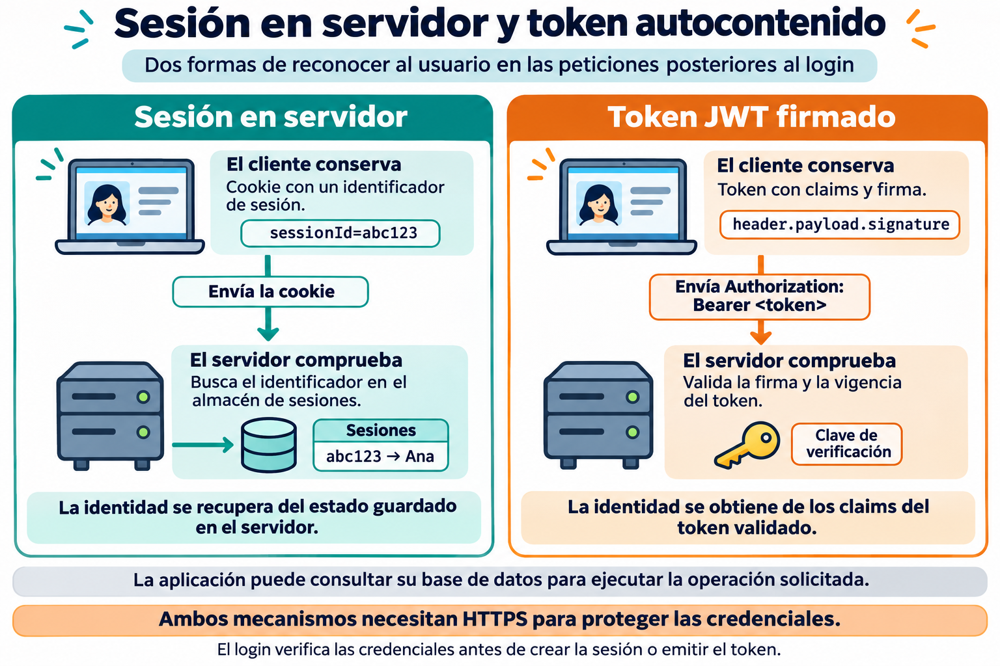
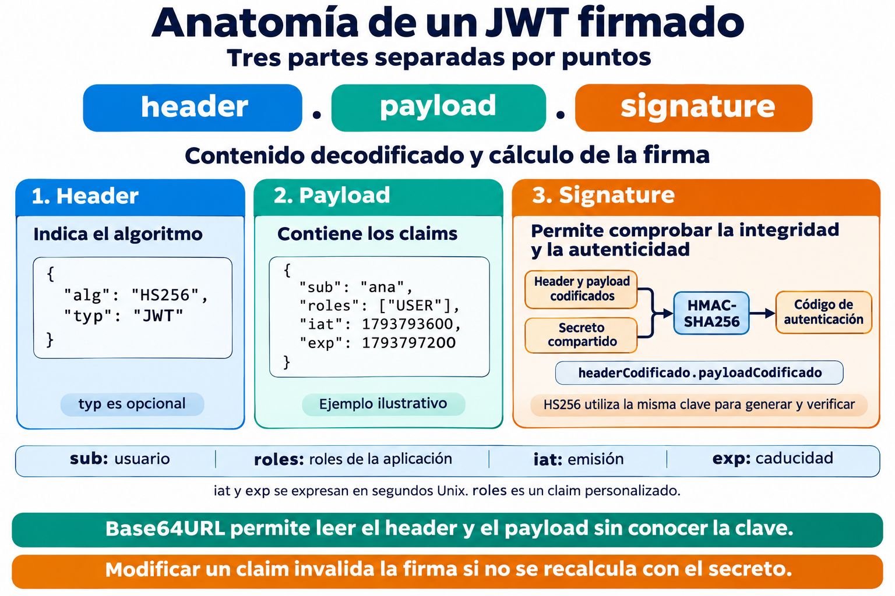
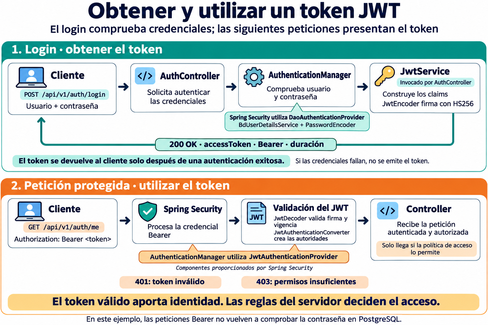
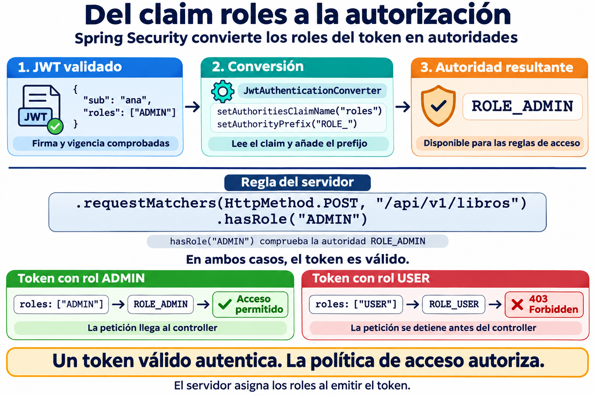
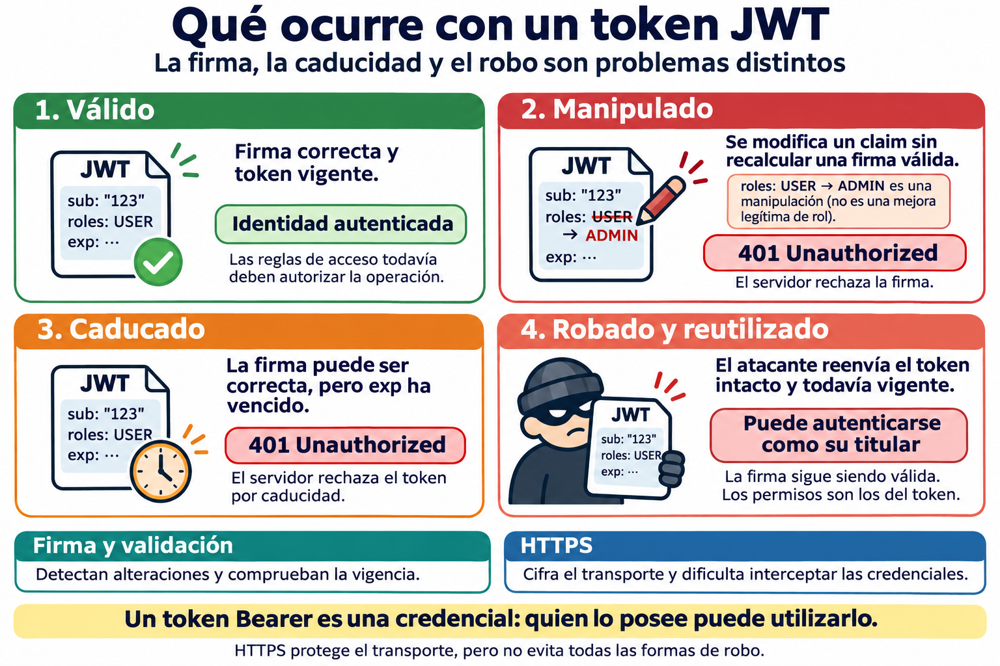

<a id="autenticacion-jwt"></a>

# 4. Autenticación con JWT

{ type=application/pdf style="width:100%;min-height:80vh" }

!!! info "Descarga de diapositivas"
    [Descarga las diapositivas](diapositivas/autenticacion-jwt.pptx){target="_blank" rel="noopener"}

## 📍 De dónde partimos

La aplicación Librería ya conserva sus usuarios en PostgreSQL y protege las contraseñas con BCrypt. El registro público crea cuentas `USER` y un proceso de inicialización incorpora el primer administrador.

Hasta ahora, HTTP Basic permitía autenticar cada petición enviando usuario y contraseña en la cabecera `Authorization`. Las rutas públicas no necesitaban esas credenciales. En este apartado, un **login** comprobará la contraseña y entregará un **token JWT** que el cliente presentará en las peticiones posteriores.

!!! tip "Qué se mantiene"
    Continúan la entidad `Usuario`, su repositorio, `BdUserDetailsService`, el bean `PasswordEncoder` y el registro. Añadirás la emisión y validación de tokens y sustituirás HTTP Basic como mecanismo para las peticiones protegidas.

## 🍪 Sesiones y tokens

HTTP es un protocolo sin estado: una petición no demuestra por sí sola que el cliente se autenticó anteriormente. La aplicación necesita un mecanismo que permita reconocerlo en las peticiones siguientes.

### 1. Dónde reside la información de autenticación

Con una **sesión en servidor**, el cliente conserva normalmente una cookie con un identificador. El servidor lo utiliza para recuperar la sesión guardada. Si existen varias instancias de la aplicación, deben poder acceder a esa información o utilizar una estrategia de afinidad de sesiones.

Con un **token autocontenido**, el cliente presenta una credencial que incorpora información sobre su identidad. El servidor comprueba su validez sin necesitar un almacén de sesiones de autenticación.



*Figura 1. Identificación del usuario mediante una sesión en servidor o un token JWT firmado. Elaboración propia.*

Ambas opciones son válidas y tienen costes distintos. Aquí utilizarás JWT para estudiar una API que autentica peticiones sin conservar sesiones de autenticación en el servidor. Esto no impide consultar PostgreSQL para obtener libros o realizar otras operaciones.

### 2. Qué significa Bearer

Un **token Bearer** es una credencial que puede utilizar quien la posee. Después del login, el cliente la envía así:

```http
Authorization: Bearer <token>
```

`<token>` representa la cadena recibida, sin los signos `<` y `>`. La contraseña vuelve a ser necesaria cuando hay que autenticarse para obtener otro token. Tanto el login como las peticiones con token necesitan HTTPS para proteger su transmisión.

## 🧬 Qué contiene un JWT firmado

JWT es un formato para representar información mediante **claims**. En este proyecto utilizarás un JWT firmado con `HS256`, cuya representación compacta tiene tres partes separadas por puntos.

### 1. Header, payload y firma

El `header` describe el algoritmo, el `payload` contiene los claims y la tercera parte permite comprobar la integridad y autenticidad del contenido.



*Figura 2. Estructura de un JWT firmado con HS256: header, payload y código de autenticación. Elaboración propia.*

Las partes se representan mediante **Base64URL**, una codificación que no oculta la información. El JSON de la figura está decodificado; no es la cadena que se envía en la cabecera HTTP. Sus fechas son ilustrativas y no corresponden a un token utilizable.

| Claim | Significado en Librería |
|---|---|
| `sub` | Nombre del usuario autenticado. |
| `iat` | Instante de emisión, en segundos Unix. |
| `exp` | Instante de caducidad, en segundos Unix. |
| `iss` | Emisor. En este ejemplo, `libreria`. |
| `roles` | Roles asignados al usuario. Es un claim personalizado. |

Los roles aportan información para autorizar, pero son las reglas del servidor las que deciden qué operaciones permiten.

### 2. Firmar con HS256

`HS256` utiliza **HMAC-SHA256** con un secreto compartido: la misma clave sirve para generar y verificar el código de autenticación. Aunque se hable habitualmente de «firma», técnicamente se trata de un MAC simétrico.

El cálculo protege el header y el payload codificados, unidos por su punto separador. Si alguien modifica un claim y conserva la firma anterior, la comprobación falla.

!!! warning "El payload es legible"
    No incluyas contraseñas ni secretos en los claims. Poder leer un token no permite modificarlo conservando una firma válida, pero quien robe un token intacto y vigente puede utilizarlo como credencial.

## 🔄 Dos recorridos de autenticación

El login verifica usuario y contraseña. Las peticiones posteriores verifican el token. Entender esta separación permite situar cada clase antes de entrar en el código.



*Figura 3. Emisión del token durante el login y validación en las peticiones protegidas. Elaboración propia.*

### 1. Obtener el token

`AuthController` pide al `AuthenticationManager` que autentique las credenciales. Spring Security utiliza `DaoAuthenticationProvider`, que se apoya en tu servicio de usuarios y en el encoder de contraseñas. Si todo es correcto, el controller solicita a `JwtService` que genere el token.

### 2. Utilizar el token

En una petición Bearer, los filtros de Spring Security delegan la autenticación en un `AuthenticationManager` con `JwtAuthenticationProvider`. Este utiliza el `JwtDecoder` y el `JwtAuthenticationConverter` para validar la credencial y construir la identidad con sus autoridades.

En este recorrido no se vuelve a comprobar la contraseña con BCrypt ni se carga al usuario desde PostgreSQL. Después se evalúan las reglas de acceso y, si lo permiten, la petición llega al controller.

!!! info "Qué tienes que programar"
    Implementas `JwtService` y el método de login. Configuras los beans de `JwtEncoder`, `JwtDecoder`, `AuthenticationManager` y los conversores utilizando clases de las bibliotecas. Los proveedores `DaoAuthenticationProvider` y `JwtAuthenticationProvider` los proporciona Spring Security; no tienes que programarlos ni crear un filtro JWT propio.

## 🔑 Preparar la configuración

Las piezas de seguridad se añaden a tu `SecurityConfig`, que continúa siendo una clase de configuración. Los fragmentos omiten imports; se indican los tipos concretos cuando pueden resultar ambiguos.

### 1. Dependencia y propiedades

Añade al `pom.xml`, junto al starter de seguridad que ya existe:

```xml
<dependency>
    <groupId>org.springframework.boot</groupId>
    <artifactId>spring-boot-starter-oauth2-resource-server</artifactId>
</dependency>
```

El starter incorpora el soporte para procesar tokens Bearer y JWT. Utilizar estas piezas no convierte tu aplicación en una implementación completa de un servidor de autorización OAuth2.

En `application-dev.yml`, conserva la importación local y añade una duración positiva, expresada en minutos:

```yaml
spring:
  config:
    import: "optional:application-dev-local.yml"

libreria:
  jwt:
    expiration-minutes: 15
```

Añade el secreto a `application-dev-local.yml`, sin eliminar la contraseña del administrador que ya contiene:

```yaml
libreria:
  admin:
    password: "tu-contraseña-local-del-administrador"
  jwt:
    secret: "sustituye-este-marcador-por-el-valor-generado"
```

Para generar un valor aleatorio desde Bash:

```bash
openssl rand -hex 32
```

Copia los 64 caracteres obtenidos en `secret`. En el código siguiente se utiliza ese texto hexadecimal directamente como bytes UTF-8, sin decodificarlo. Procede de 32 bytes aleatorios y su representación ocupa 64 bytes ASCII.

!!! warning "El secreto queda fuera de Git"
    HS256 requiere una clave de al menos 32 bytes y suficientemente aleatoria. No utilices una frase predecible ni el marcador del ejemplo. Actualiza también la plantilla `.example` con la nueva propiedad, pero sin copiar el valor real. El fichero local continúa excluido de Git y el perfil `dev` debe estar activo para cargarlo.

### 2. Encoder, decoder y AuthenticationManager

En `SecurityConfig`, añade el campo y los beans siguientes. `ImmutableSecret` pertenece a `com.nimbusds.jose.jwk.source`; `SecretKeySpec`, a `javax.crypto.spec`.

```java
@Value("${libreria.jwt.secret}")
private String jwtSecret;

@Bean
public JwtEncoder jwtEncoder() {
    return new NimbusJwtEncoder(
            new ImmutableSecret<>(jwtSecret.getBytes(StandardCharsets.UTF_8))
    );
}

@Bean
public JwtDecoder jwtDecoder() {
    SecretKeySpec secretKey = new SecretKeySpec(
            jwtSecret.getBytes(StandardCharsets.UTF_8), "HmacSHA256"
    );
    NimbusJwtDecoder decoder = NimbusJwtDecoder.withSecretKey(secretKey)
            .macAlgorithm(MacAlgorithm.HS256)
            .build();
    decoder.setJwtValidator(JwtValidators.createDefaultWithIssuer("libreria"));
    return decoder;
}

@Bean
public AuthenticationManager authenticationManager(
        AuthenticationConfiguration configuration) throws Exception {
    return configuration.getAuthenticationManager();
}
```

El encoder firma con la clave configurada. El decoder acepta `HS256` y comprueba la firma, la ventana temporal y el emisor `libreria`. Declarar `iss` al emitirlo no basta: aquí también configuras su validación.

El último bean permite inyectar en tu controller el gestor que utilizará el servicio de usuarios y el encoder existentes para autenticar el login. Mantén retirado el antiguo `InMemoryUserDetailsManager`.

## 🎫 Emitir el token en el login

La emisión comienza con credenciales válidas y termina con una respuesta que contiene el token y su duración. Las clases de este apartado se añaden a las que ya existen.

### 1. Construir los claims con `JwtService`

```java
@Service
@RequiredArgsConstructor
public class JwtService {

    private final JwtEncoder jwtEncoder;

    @Value("${libreria.jwt.expiration-minutes}")
    private long expirationMinutes;

    public String generarToken(Authentication authentication) {
        Instant ahora = Instant.now();
        List<String> roles = authentication.getAuthorities().stream()
                .map(GrantedAuthority::getAuthority)
                .filter(a -> a.startsWith("ROLE_"))
                .map(a -> a.substring("ROLE_".length()))
                .toList();

        JwtClaimsSet claims = JwtClaimsSet.builder()
                .issuer("libreria")
                .issuedAt(ahora)
                .expiresAt(ahora.plusSeconds(getExpiresInSeconds()))
                .subject(authentication.getName())
                .claim("roles", roles)
                .build();

        JwsHeader header = JwsHeader.with(MacAlgorithm.HS256).build();
        return jwtEncoder.encode(JwtEncoderParameters.from(header, claims))
                .getTokenValue();
    }

    public long getExpiresInSeconds() {
        return expirationMinutes * 60;
    }
}
```

El servicio recibe un `Authentication` ya validado. Extrae sus roles, elimina el prefijo `ROLE_` y construye los claims. No acepta roles enviados en el JSON del login.

`getExpiresInSeconds()` expresa la duración configurada en la unidad utilizada por la respuesta. No calcula en cada llamada cuánto le queda a un token antiguo.

### 2. Ampliar `AuthController`

Define estos DTO en sus propios ficheros:

```java
public record LoginRequestDTO(
        @NotBlank(message = "El nombre de usuario no puede estar vacío") String username,
        @NotBlank(message = "La contraseña no puede estar vacía") String password
) {}
```

```java
public record LoginResponseDTO(
        String accessToken, String tokenType, long expiresInSeconds
) {}
```

Añade a tu `AuthController` las dos dependencias siguientes y el método de login. Conserva las dependencias y el método de registro anteriores:

```java
private final AuthenticationManager authenticationManager;
private final JwtService jwtService;

@Operation(summary = "Autenticarse y obtener un token JWT")
@ApiResponses({
        @ApiResponse(responseCode = "200", description = "Token generado"),
        @ApiResponse(responseCode = "400", description = "Datos de entrada inválidos"),
        @ApiResponse(responseCode = "401", description = "Credenciales incorrectas")
})
@PostMapping("/login")
public ResponseEntity<LoginResponseDTO> login(@Valid @RequestBody LoginRequestDTO dto) {
    Authentication authentication = authenticationManager.authenticate(
            new UsernamePasswordAuthenticationToken(dto.username(), dto.password())
    );
    String token = jwtService.generarToken(authentication);
    return ResponseEntity.ok(
            new LoginResponseDTO(token, "Bearer", jwtService.getExpiresInSeconds())
    );
}
```

`@RequestMapping("/api/v1/auth")` y `@RequiredArgsConstructor` siguen en la clase. Lombok incluirá los nuevos campos `final` en el constructor. `tokenType` indica cómo presentar `accessToken` en la cabecera.

### 3. Gestionar las credenciales incorrectas

Si la autenticación falla, `authenticate(...)` lanza una `AuthenticationException`. Como ahora la llamada ocurre dentro de un controller, puedes gestionarla en el `GlobalExceptionHandler` existente:

```java
@ExceptionHandler(AuthenticationException.class)
public ResponseEntity<ErrorResponse> handleAuthenticationException(
        AuthenticationException ex, HttpServletRequest request) {
    ErrorResponse response = new ErrorResponse(
            LocalDateTime.now().toString(), 401, "No autenticado",
            "Usuario o contraseña incorrectos", request.getRequestURI()
    );
    return ResponseEntity.status(HttpStatus.UNAUTHORIZED).body(response);
}
```

La excepción es `org.springframework.security.core.AuthenticationException`. El mensaje público no revela si la cuenta existe o está deshabilitada. El handler genérico anterior continúa resolviendo las excepciones que no tengan un tratamiento más específico.

| Situación | Dónde se produce el fallo | Quién responde |
|---|---|---|
| Login con credenciales incorrectas | En `AuthController.login(...)`. | Este `@ExceptionHandler`, con `401`. |
| `GET /api/v1/auth/me` sin token o con uno inválido | En los filtros de seguridad. | El `AuthenticationEntryPoint`, con `401`. |
| Usuario autenticado sin el rol requerido | En la autorización previa al controller. | El `AccessDeniedHandler`, con `403`. |

## 🛡️ Validar y autorizar las peticiones

El token aporta una identidad y unos roles. Para utilizarlos, necesitas configurar su conversión a autoridades y activar la autenticación Bearer en la cadena de seguridad.

### 1. Traducir `roles` a autoridades

Por defecto, el conversor de Spring utiliza los scopes de `scope` o `scp` y les añade el prefijo `SCOPE_`. Librería utiliza un claim propio llamado `roles`, por lo que debes indicar cómo leerlo:

```java
@Bean
public JwtAuthenticationConverter jwtAuthenticationConverter() {
    JwtGrantedAuthoritiesConverter authoritiesConverter = new JwtGrantedAuthoritiesConverter();
    authoritiesConverter.setAuthoritiesClaimName("roles");
    authoritiesConverter.setAuthorityPrefix("ROLE_");

    JwtAuthenticationConverter converter = new JwtAuthenticationConverter();
    converter.setJwtGrantedAuthoritiesConverter(authoritiesConverter);
    return converter;
}
```



*Figura 4. Conversión de los roles del JWT a autoridades de Spring Security y evaluación de la política de acceso. Elaboración propia.*

El `JwtGrantedAuthoritiesConverter` realiza la extracción y añade el prefijo. El `JwtAuthenticationConverter` lo utiliza para construir la autenticación. Así, `hasRole("ADMIN")` comprueba la autoridad `ROLE_ADMIN`.

### 2. Sustituir HTTP Basic en `SecurityFilterChain`

Sustituye el bean anterior por el siguiente. Además de mantener las lecturas públicas, concreta una regla de ejemplo: **crear libros requiere `ADMIN`**. Esto hace reproducible la comparación de la figura 4; las demás rutas siguen exigiendo autenticación.

```java
@Bean
public SecurityFilterChain securityFilterChain(
        HttpSecurity http,
        AuthenticationEntryPoint customAuthenticationEntryPoint,
        JwtAuthenticationConverter jwtAuthenticationConverter) throws Exception {

    AuthenticationEntryPoint bearerEntryPoint = (request, response, ex) -> {
        response.setHeader(HttpHeaders.WWW_AUTHENTICATE, "Bearer");
        customAuthenticationEntryPoint.commence(request, response, ex);
    };

    return http
            .sessionManagement(session -> session
                    .sessionCreationPolicy(SessionCreationPolicy.STATELESS))
            .authorizeHttpRequests(auth -> auth
                    .requestMatchers(HttpMethod.POST,
                            "/api/v1/auth/register", "/api/v1/auth/login").permitAll()
                    .requestMatchers(HttpMethod.GET, "/api/v1/libros/**").permitAll()
                    .requestMatchers("/v3/api-docs/**", "/swagger-ui/**",
                            "/swagger-ui.html", "/documentacion").permitAll()
                    .requestMatchers(HttpMethod.POST, "/api/v1/libros").hasRole("ADMIN")
                    .anyRequest().authenticated()
            )
            .exceptionHandling(exceptions -> exceptions
                    .authenticationEntryPoint(bearerEntryPoint))
            .csrf(AbstractHttpConfigurer::disable)
            .oauth2ResourceServer(oauth2 -> oauth2
                    .authenticationEntryPoint(bearerEntryPoint)
                    .jwt(jwt -> jwt.jwtAuthenticationConverter(jwtAuthenticationConverter)))
            .httpBasic(AbstractHttpConfigurer::disable)
            .build();
}
```

`STATELESS` indica que Spring Security no creará una sesión HTTP ni la utilizará para recuperar la autenticación. `oauth2ResourceServer(...).jwt(...)` activa el procesamiento de JWT y HTTP Basic queda desactivado. No necesitas implementar un filtro para leer manualmente la cabecera.

El entry point se conecta también al resource server para dar el mismo `ErrorResponse` a los fallos de validación del token. El pequeño adaptador conserva la cabecera de desafío `WWW-Authenticate: Bearer` y delega el cuerpo JSON en tu componente existente. Este debe escribir un mensaje público genérico y conservar la cabecera.

!!! note "El 403 tiene su propio tratamiento"
    La configuración mantiene el tratamiento de acceso denegado del resource server. El estado será `403`, pero su cuerpo no adopta automáticamente tu `ErrorResponse`. Para uniformarlo se necesita un `AccessDeniedHandler` propio, una ampliación distinta de la gestión del `401`.

Desactivas CSRF en el escenario de esta API, donde el cliente aporta explícitamente el token en `Authorization`. Si cambias el mecanismo para que el navegador envíe credenciales automáticamente mediante cookies, debes revisar esa decisión.

!!! warning "Una ruta pública no ignora un token incorrecto"
    `permitAll()` permite acceder sin credenciales. Si envías una cabecera Bearer con un token inválido, el filtro puede rechazarla antes de evaluar el acceso público. Para repetir el login tras una caducidad, retira el token antiguo de esa petición.

### 3. Consultar la identidad con `/me`

Define un DTO de respuesta y añade el método al mismo `AuthController`. El parámetro `Authentication` lo proporciona Spring MVC a partir del contexto de seguridad:

```java
public record AuthMeResponse(String username, List<String> roles) {}
```

```java
@GetMapping("/me")
public ResponseEntity<AuthMeResponse> getCurrentUser(Authentication authentication) {
    List<String> roles = authentication.getAuthorities().stream()
            .map(GrantedAuthority::getAuthority)
            .filter(a -> a.startsWith("ROLE_"))
            .map(a -> a.substring("ROLE_".length()))
            .toList();
    return ResponseEntity.ok(new AuthMeResponse(authentication.getName(), roles));
}
```

Este endpoint refleja la identidad del **token validado**, no una lectura actualizada del usuario en PostgreSQL. Es una ruta protegida porque no coincide con ninguna regla pública.

## 📖 Documentar y comprobar el acceso

La configuración de Spring protege la aplicación. OpenAPI describe esa protección y permite que Swagger UI envíe la cabecera de forma cómoda; no sustituye las reglas del backend.

### 1. Declarar Bearer en OpenAPI

Actualiza el bean de `OpenApiConfig`, conservando el resto de metadatos que ya tengas:

```java
@Bean
public OpenAPI libreriaOpenAPI() {
    return new OpenAPI()
            .info(new Info()
                    .title("Mi librería")
                    .version("v1")
                    .description("API de la librería del curso."))
            .components(new Components()
                    .addSecuritySchemes("bearerAuth", new SecurityScheme()
                            .type(SecurityScheme.Type.HTTP)
                            .scheme("bearer")
                            .bearerFormat("JWT")));
}
```

Aquí defines el esquema sin aplicarlo globalmente. En los métodos protegidos, como `/me` o la creación de libros, añade a su `@Operation` el requisito correspondiente:

```java
@Operation(summary = "Consultar mi identidad",
        security = @SecurityRequirement(name = "bearerAuth"))
@GetMapping("/me")
```

`SecurityRequirement` es la anotación de `io.swagger.v3.oas.annotations.security`. No dupliques el método: incorpora la anotación al que acabas de crear. Login, registro y lecturas públicas no llevan ese requisito. Si existía un `addSecurityItem(...)` global o una anotación de seguridad en toda la clase, retíralos para mantener esta estrategia coherente.

### 2. Comprobar con Swagger UI y curl

Abre `/documentacion` y ejecuta `POST /api/v1/auth/login` con las credenciales de una cuenta existente. Copia `accessToken`, pulsa **Authorize** y pega solo el token: Swagger UI añade `Bearer`.

Prueba `/me`. Debe devolver el nombre y los roles de la cuenta utilizada. Para reproducir la comprobación desde Bash, introduce el token cuando se solicite:

```bash
read -r -s -p 'Pega el accessToken: ' TOKEN
printf '\n'
curl -i http://localhost:8080/api/v1/auth/me \
  -H "Authorization: Bearer $TOKEN"
```

Compara con la misma ruta sin credencial y con una credencial inválida:

```bash
curl -i http://localhost:8080/api/v1/auth/me
curl -i http://localhost:8080/api/v1/auth/me \
  -H 'Authorization: Bearer token-invalido'
unset TOKEN
```

La primera petición, con un token vigente emitido por tu aplicación, debe devolver `200`; las dos últimas, `401`. No utilices un GET público de libros para demostrar que falta autenticación.

Para comprobar la autorización, utiliza en Swagger UI la creación de libros con un cuerpo válido: una cuenta `USER` debe recibir `403`, mientras que una cuenta `ADMIN` debe superar la regla de acceso. El resultado final también depende de las validaciones y de los datos del libro.

## 🔒 Límites del token y protección del transporte

Validar la firma, comprobar la vigencia y autorizar una operación resuelven problemas diferentes. La última figura resume qué ocurre cuando cambia la credencial o quién la utiliza.



*Figura 5. Comportamiento de un JWT válido, manipulado, caducado o robado y alcance de la protección de HTTPS. Elaboración propia.*

### 1. HTTPS y custodia de la credencial

HTTPS cifra el transporte mediante TLS. Protege tanto la contraseña del login como el token de las peticiones posteriores frente a la interceptación del tráfico. La firma del JWT protege su integridad y autenticidad, pero deja el contenido legible.

En las pruebas locales de estos apuntes se utiliza HTTP para centrar la atención en el mecanismo. Esa simplificación no debe trasladarse a un servicio expuesto. HTTPS tampoco evita todas las formas de robo: no publiques tokens, no los subas a Git ni los copies en capturas o herramientas externas con credenciales reales.

### 2. Caducidad, cierre de sesión y cambios de cuenta

La implementación no mantiene una lista de tokens emitidos ni revocados. Eliminar el token del cliente al cerrar sesión no invalida una copia que conserve otra persona.

Lo mismo ocurre si deshabilitas una cuenta o modificas sus roles: el cambio afecta a los siguientes logins, pero los tokens emitidos conservan sus claims hasta que dejan de ser aceptados. En particular, `activo = false` impide obtener nuevos tokens, sin retirar automáticamente los anteriores.

??? info "Revocación y refresh tokens"
    Una lista de revocación o una comprobación del estado de la cuenta permite retirar acceso antes de la caducidad, a cambio de consultar estado adicional. Los tokens de acceso cortos limitan el tiempo durante el que una credencial robada sigue siendo útil.

    Un *refresh token* permite solicitar nuevos tokens de acceso bajo una política propia. Revocarlo puede impedir renovaciones, pero no invalida por sí mismo un token de acceso ya emitido. Estas ampliaciones quedan fuera de esta implementación.

La validación temporal suele admitir un pequeño margen por diferencias entre relojes. Si reduces la duración para comprobar la caducidad, espera también ese margen antes de concluir que `exp` no funciona.

## ✅ Ideas clave

??? tip "Abrir resumen"
    - El login conserva la comprobación de usuario y contraseña mediante PostgreSQL y BCrypt. Después, el cliente presenta un token Bearer.
    - El JWT firmado contiene claims legibles. HS256 permite comprobar integridad y autenticidad utilizando un secreto compartido.
    - Spring Security autentica el token con sus componentes. Configuras el decoder y la conversión de `roles` a autoridades `ROLE_`.
    - Un token válido no concede acceso a todo: las reglas del servidor autorizan cada operación. Los fallos de autenticación producen `401`; la falta de permisos, `403`.
    - Swagger UI documenta el mecanismo y facilita enviarlo. La protección real reside en la configuración de Spring Security.
    - HTTPS y la custodia del token siguen siendo necesarios. Cerrar sesión o desactivar una cuenta no revoca automáticamente los JWT emitidos.

<!-- Referencias técnicas de la revisión:
https://docs.spring.io/spring-security/reference/servlet/oauth2/resource-server/jwt.html
https://docs.spring.io/spring-security/reference/api/java/org/springframework/security/config/annotation/web/configurers/oauth2/server/resource/OAuth2ResourceServerConfigurer.html
https://swagger.io/docs/specification/v3_0/authentication/bearer-authentication/
-->
