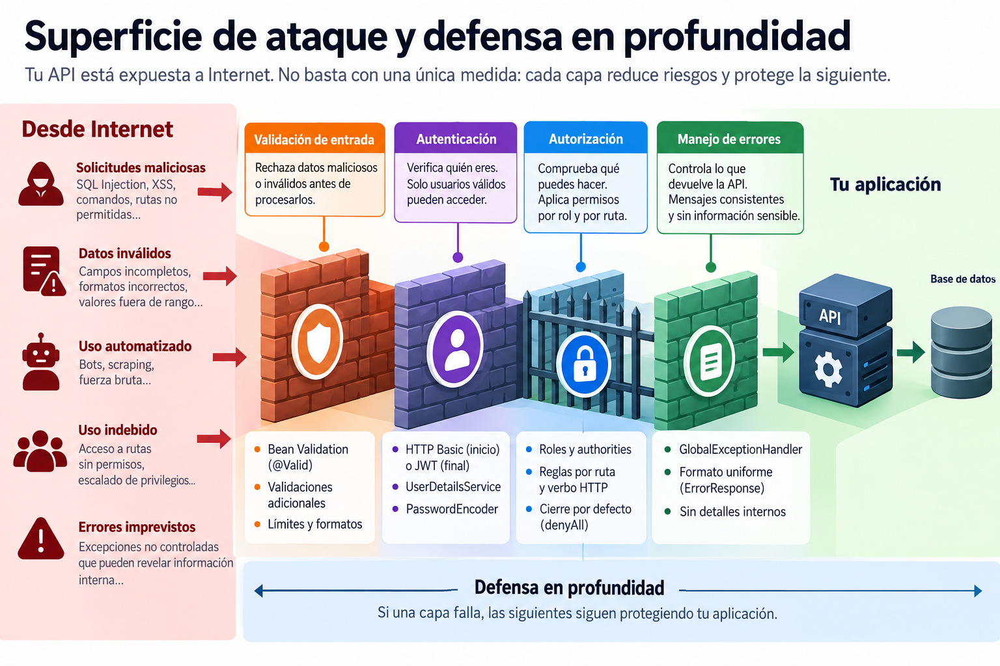
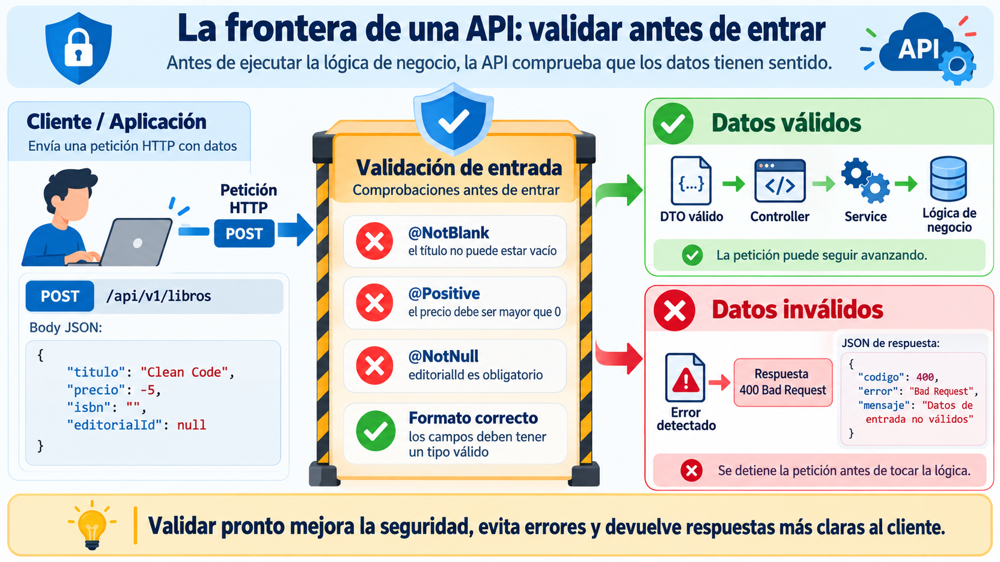
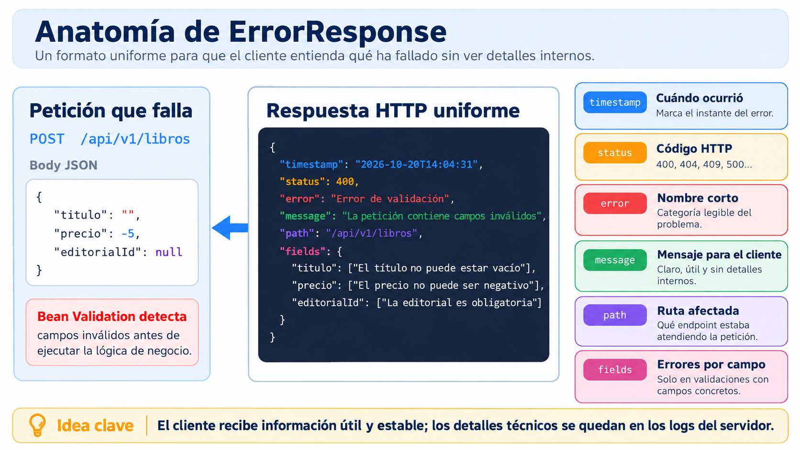
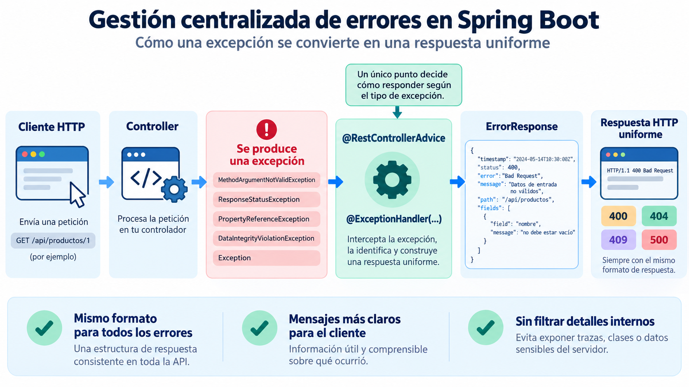
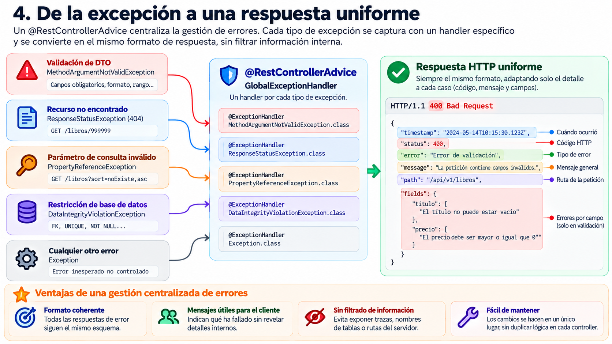

<a id="principios-programacion-segura"></a>

# 🧩 1. Principios de programación segura: validación y gestión de errores

{ type=application/pdf style="width:100%;min-height:80vh" }

!!!info "Descarga de diapositivas"
    [Descarga las diapositivas](diapositivas/principios-programacion-segura.pptx){target="_blank" rel="noopener"}

---

Hasta ahora has construido APIs que reciben peticiones, ejecutan lógica de negocio y devuelven respuestas. Pero una aplicación expuesta a otros clientes tiene que asumir algo importante: **no controla qué datos van a llegarle**.

Un formulario puede estar mal rellenado, una aplicación cliente puede contener un error y alguien puede enviar peticiones deliberadamente manipuladas. Antes de hablar de login, usuarios o tokens, conviene resolver una cuestión más básica: **cómo evitar que datos incorrectos o errores internos atraviesen la aplicación sin control**.

!!! example "Un problema sencillo, sin necesidad de un atacante"
    Imagina una API de librería que recibe un `POST /api/v1/libros` con un precio negativo. `@Valid` puede rechazar la petición, pero una respuesta genérica de Spring no siempre explica con claridad qué campo ha fallado.

    Ahora imagina un listado solicitado con `?sort=noExiste,asc`. Si esa situación termina en un `500 Internal Server Error`, la API está presentando como fallo del servidor algo que en realidad ha provocado el cliente al pedir un campo inexistente.

Estos problemas ya forman parte de la seguridad: **validar correctamente lo que entra y controlar cuidadosamente lo que sale**.

---

## 🔒 Qué significa que una aplicación sea segura

La seguridad no consiste únicamente en impedir que alguien acceda sin contraseña. Clásicamente se apoya en tres propiedades que una aplicación debe proteger:

| Pilar | En una aplicación web |
|---|---|
| **Confidencialidad** | Que nadie pueda leer información para la que no tiene permiso. |
| **Integridad** | Que los datos no puedan modificarse de forma indebida. |
| **Disponibilidad** | Que el servicio continúe funcionando cuando debe hacerlo. |

Una misma decisión puede contribuir a más de un pilar. Por ejemplo, controlar quién puede modificar un recurso protege su integridad, mientras que limitar abusos o peticiones costosas ayuda a preservar la disponibilidad.

---

## 🎯 Superficie de ataque y defensa en profundidad

Toda API tiene una **superficie de ataque**: el conjunto de puntos mediante los cuales algo externo puede interactuar con ella. No se limita al formulario de login. También incluye endpoints, cuerpos JSON, parámetros de consulta, identificadores en la URL, cabeceras, mensajes de error y configuración expuesta.



*Figura 1. Superficie de ataque de una API y aplicación de varias capas de defensa. Elaboración propia.*

!!! warning "La regla de oro"
    **Nunca te fíes de lo que llega de fuera.** Un dato externo debe considerarse no confiable hasta que la aplicación haya comprobado que cumple las reglas esperadas.

Esa idea se traduce en varios principios de diseño:

| Principio | Aplicación práctica |
|---|---|
| **Validar en la frontera** | Comprobar los datos antes de que lleguen a la lógica de negocio. |
| **Mínimo privilegio / mínima exposición** | Mantener cerrado por defecto y abrir únicamente lo necesario. |
| **No filtrar información interna** | No devolver trazas, nombres de tablas, rutas internas ni detalles de implementación. |
| **No guardar secretos en el código** | Mantener contraseñas, claves y tokens en configuración externa. |
| **Defensa en profundidad** | Aplicar varias capas de protección para que el fallo de una no deje toda la aplicación expuesta. |

Estos principios ayudan a reducir problemas muy distintos: inyección de datos, entradas malformadas, fuerza bruta, exposición de información o uso abusivo de recursos. No todos se resolverán hoy; esta sesión se centra en dos de ellos: **validación de entrada** y **gestión segura de errores**.

---

## 🛠️ Dos prácticas concretas

Vamos a aplicar esos dos principios sobre una API de librería sencilla. Primero impediremos que datos inválidos entren en la lógica de negocio. Después convertiremos distintos tipos de excepción en respuestas HTTP coherentes y controladas.

### 1. Validación de entrada con Bean Validation

Las anotaciones de Bean Validation (`@NotBlank`, `@NotNull`, `@PositiveOrZero`...) permiten declarar restricciones directamente en los DTO de entrada.



*Figura 2. Validación de los datos en la frontera antes de ejecutar la lógica de negocio. Elaboración propia.*

Por ejemplo:

```java
public record LibroCreateDTO(
        @NotBlank(message = "El título no puede estar vacío")
        @Size(max = 150, message = "El título no puede superar los 150 caracteres")
        String titulo,

        @NotNull(message = "El precio es obligatorio")
        @PositiveOrZero(message = "El precio no puede ser negativo")
        BigDecimal precio,

        @NotNull(message = "La editorial es obligatoria")
        @Positive(message = "La editorial debe tener un identificador válido")
        Long editorialId
) {}
```

El atributo `message` permite controlar la explicación asociada a cada incumplimiento. Si no se especifica, Bean Validation utiliza su mensaje predeterminado.

En el controller, `@Valid` activa esas comprobaciones antes de ejecutar el cuerpo del método:

```java
@PostMapping
public ResponseEntity<LibroResponseDTO> create(
        @Valid @RequestBody LibroCreateDTO dto) {
    // ...
}
```

Si el DTO no cumple las restricciones, la petición se detiene antes de entrar en la lógica de negocio. Eso es **validar en la frontera**: rechazar el dato incorrecto en la puerta, no después de haberlo propagado por la aplicación.

### 2. Gestión centralizada de errores

Validar es solo la mitad del problema. También necesitamos decidir **cómo se comunica el fallo al cliente**.

En lugar de permitir que cada controller construya los errores de una forma diferente, podemos definir un único formato:

```java
public record ErrorResponse(
        String timestamp,
        int status,
        String error,
        String message,
        String path,
        Map<String, List<String>> fields
) {
    public ErrorResponse(
            String timestamp,
            int status,
            String error,
            String message,
            String path) {
        this(timestamp, status, error, message, path, Map.of());
    }
}
```



*Figura 3. Campos de una respuesta de error uniforme para una API REST. Elaboración propia.*

Cada campo tiene una responsabilidad concreta:

- `timestamp`: cuándo ocurrió el error.
- `status`: código HTTP.
- `error`: nombre breve del problema.
- `message`: explicación comprensible para quien consume la API.
- `path`: endpoint que estaba atendiendo la petición.
- `fields`: errores asociados a campos concretos cuando la validación puede identificarlos.

El siguiente paso es conseguir que excepciones distintas terminen utilizando siempre esta estructura.



*Figura 4. Conversión centralizada de excepciones en respuestas HTTP uniformes mediante `@RestControllerAdvice`. Elaboración propia.*

`@RestControllerAdvice` marca una clase como punto transversal para los controllers de la aplicación. Dentro de ella, cada método anotado con `@ExceptionHandler(...)` indica qué tipo de excepción sabe tratar.

La idea es:

```text
excepción
    ↓
@RestControllerAdvice
    ↓
@ExceptionHandler específico
    ↓
ErrorResponse
    ↓
respuesta HTTP
```

Vas a ver cinco situaciones representativas.

#### Handler 1: un DTO que no supera la validación

Cuando `@Valid` detecta que el DTO incumple alguna restricción, Spring lanza `MethodArgumentNotValidException`.

```java
@ExceptionHandler(MethodArgumentNotValidException.class)
public ResponseEntity<ErrorResponse> handleValidationExceptions(
        MethodArgumentNotValidException ex,
        HttpServletRequest request) {

    Map<String, List<String>> fields = ex.getBindingResult()
            .getFieldErrors()
            .stream()
            .collect(Collectors.groupingBy(
                    FieldError::getField,
                    Collectors.mapping(
                            FieldError::getDefaultMessage,
                            Collectors.toList()
                    )
            ));

    ErrorResponse response = new ErrorResponse(
            LocalDateTime.now().toString(),
            400,
            "Error de validación",
            "La petición contiene campos inválidos",
            request.getRequestURI(),
            fields
    );

    return ResponseEntity
            .status(HttpStatus.BAD_REQUEST)
            .body(response);
}
```

`getFieldErrors()` devuelve los campos que han fallado. La agrupación posterior construye un mapa `campo → lista de mensajes`, de modo que un mismo campo puede mostrar más de un incumplimiento.

El resultado es un `400 Bad Request`: el servidor ha entendido la petición, pero los datos enviados no cumplen las reglas de entrada.

#### Handler 2: errores que la aplicación lanza explícitamente

En la lógica de negocio es habitual utilizar `ResponseStatusException` para indicar una situación concreta. Por ejemplo, al buscar un libro inexistente:

```java
libroRepository.findById(id)
        .orElseThrow(() -> new ResponseStatusException(
                HttpStatus.NOT_FOUND,
                "Libro no encontrado"));
```

Podemos conservar el código que lleva la propia excepción y adaptarlo al formato común:

```java
@ExceptionHandler(ResponseStatusException.class)
public ResponseEntity<ErrorResponse> handleResponseStatusException(
        ResponseStatusException ex,
        HttpServletRequest request) {

    int statusCode = ex.getStatusCode().value();
    HttpStatus status = HttpStatus.resolve(statusCode);

    String error = status != null
            ? status.getReasonPhrase()
            : "Error";

    String message = ex.getReason() != null
            ? ex.getReason()
            : error;

    ErrorResponse response = new ErrorResponse(
            LocalDateTime.now().toString(),
            statusCode,
            error,
            message,
            request.getRequestURI()
    );

    return ResponseEntity
            .status(ex.getStatusCode())
            .body(response);
}
```

A diferencia del handler anterior, aquí el código no está fijado a `400`: depende de la excepción que haya lanzado la aplicación.

#### Handler 3: un parámetro que Spring Data no sabe interpretar

Supón que un endpoint admite ordenación y el cliente solicita:

```text
GET /api/v1/libros?sort=noExiste,asc
```

Spring Data intenta localizar una propiedad llamada `noExiste`. Como no existe en la entidad, puede lanzar `PropertyReferenceException`.

Ese error procede de una entrada incorrecta del cliente, por lo que tiene más sentido responder con `400 Bad Request` que con un `500 Internal Server Error`.

```java
@ExceptionHandler(PropertyReferenceException.class)
public ResponseEntity<ErrorResponse> handlePropertyReferenceException(
        PropertyReferenceException ex,
        HttpServletRequest request) {

    ErrorResponse response = new ErrorResponse(
            LocalDateTime.now().toString(),
            400,
            "Parámetro inválido",
            "Uno de los parámetros de la consulta no es válido",
            request.getRequestURI()
    );

    return ResponseEntity
            .status(HttpStatus.BAD_REQUEST)
            .body(response);
}
```

No devolvemos detalles internos de la excepción: el cliente necesita saber qué tipo de problema ha cometido, no cómo Spring Data lo ha detectado internamente.

#### Handler 4: una restricción protegida por la base de datos

Bean Validation puede comprobar reglas que dependen de los datos recibidos, pero otras restricciones solo pueden verificarse teniendo en cuenta el estado de la base de datos.

Por ejemplo:

| Operación | Qué ocurre |
|---|---|
| Crear un libro con un `editorialId` inexistente | El service puede comprobar antes si existe la editorial y lanzar un `404` controlado. |
| Eliminar una editorial que todavía tiene libros asociados | La base de datos puede impedir el borrado mediante una clave foránea. |

Spring traduce normalmente una violación de integridad de datos a `DataIntegrityViolationException`.

```java
@ExceptionHandler(DataIntegrityViolationException.class)
public ResponseEntity<ErrorResponse> handleDataIntegrityViolationException(
        DataIntegrityViolationException ex,
        HttpServletRequest request) {

    ErrorResponse response = new ErrorResponse(
            LocalDateTime.now().toString(),
            409,
            "Conflicto de datos",
            "La operación entra en conflicto con el estado actual de los datos",
            request.getRequestURI()
    );

    return ResponseEntity
            .status(HttpStatus.CONFLICT)
            .body(response);
}
```

Aquí utilizamos `409 Conflict`: la petición puede estar correctamente construida, pero no puede completarse porque entra en conflicto con el estado actual del sistema.

#### Handler 5: la red de seguridad final

Los handlers anteriores representan fallos conocidos. Aun así, puede producirse una excepción para la que no exista tratamiento específico.

Un handler genérico evita que el cliente reciba una respuesta inconsistente o detalles internos:

```java
@ExceptionHandler(Exception.class)
public ResponseEntity<ErrorResponse> handleGenericException(
        Exception ex,
        HttpServletRequest request) {

    ErrorResponse response = new ErrorResponse(
            LocalDateTime.now().toString(),
            500,
            "Error interno",
            "Ha ocurrido un error inesperado",
            request.getRequestURI()
    );

    return ResponseEntity
            .status(HttpStatus.INTERNAL_SERVER_ERROR)
            .body(response);
}
```

!!! warning "No devuelvas `ex.getMessage()` al cliente"
    El mensaje real de una excepción puede revelar nombres de clases, tablas, consultas, rutas del servidor u otros detalles internos.

    La respuesta HTTP debe ser segura y comprensible. La información técnica completa se registra en los **logs del servidor**, donde sí puede utilizarse para diagnosticar el problema.



*Figura 5. Distintos tipos de excepción se convierten en respuestas HTTP coherentes mediante handlers específicos y uno genérico de respaldo. Elaboración propia.*

La prioridad no depende del orden en que aparecen los métodos en la clase. Spring selecciona el `@ExceptionHandler` compatible **más específico**. Por eso `Exception.class` puede actuar como red de seguridad sin impedir que los handlers concretos gestionen primero sus propios casos.

!!! info "Una frontera importante"
    `@RestControllerAdvice` trabaja dentro del circuito de Spring MVC. Más adelante verás que algunos errores de Spring Security se producen **antes** de llegar al `DispatcherServlet`; esos casos necesitan mecanismos específicos como `AuthenticationEntryPoint` o `AccessDeniedHandler`.

---

## 🗺️ Lo que viene

Esta sesión ha materializado dos principios: **validar en la frontera** y **no filtrar información interna en los errores**.

Los apartados siguientes incorporarán progresivamente las demás capas:

- Spring Security introducirá autenticación y una primera política de acceso.
- BCrypt permitirá almacenar contraseñas sin conservar su texto original.
- JWT sustituirá el envío de usuario y contraseña en cada petición por un token firmado.
- La política final de rutas aplicará mínima exposición y cierre por defecto.

Cada pieza resolverá un problema concreto de la versión anterior.

---

## ✅ Ideas clave

??? tip "Abrir resumen"

    - La seguridad se apoya en **confidencialidad, integridad y disponibilidad**.
    - La **superficie de ataque** incluye todo punto por el que algo externo puede interactuar con la aplicación.
    - La regla básica es **no confiar en los datos externos hasta validarlos**.
    - Bean Validation y `@Valid` permiten rechazar entradas incorrectas antes de ejecutar la lógica de negocio.
    - Un `ErrorResponse` común hace que los errores tengan una estructura predecible para los clientes.
    - `@RestControllerAdvice` y `@ExceptionHandler` centralizan la transformación de excepciones en respuestas HTTP.
    - No todo fallo debe convertirse en `500`: una entrada incorrecta puede ser `400`, un recurso inexistente `404` y un conflicto con el estado de los datos `409`.
    - El handler genérico es una red de seguridad, pero nunca debe filtrar al cliente el mensaje técnico de la excepción.
    - La defensa en profundidad combina varias capas; validación y gestión de errores son solo las primeras.
