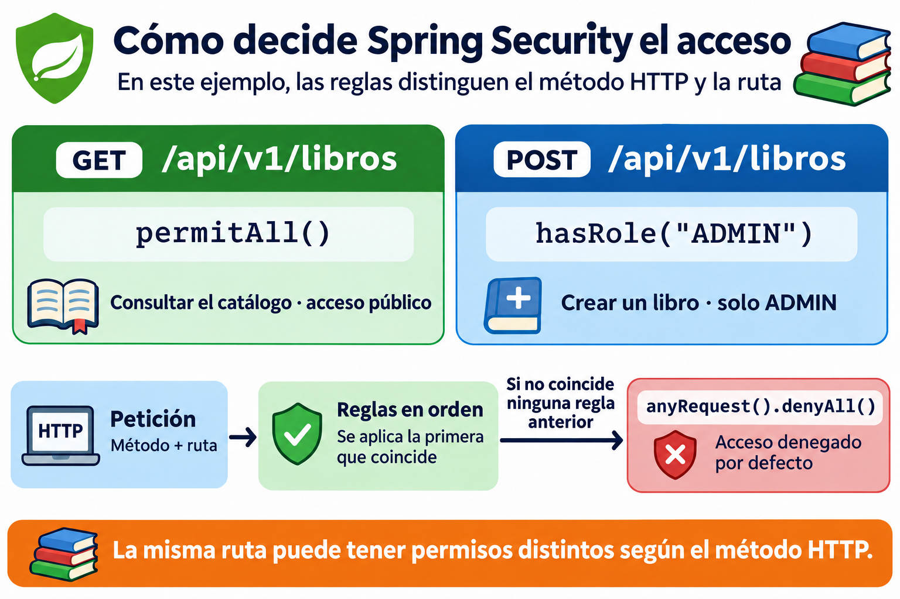
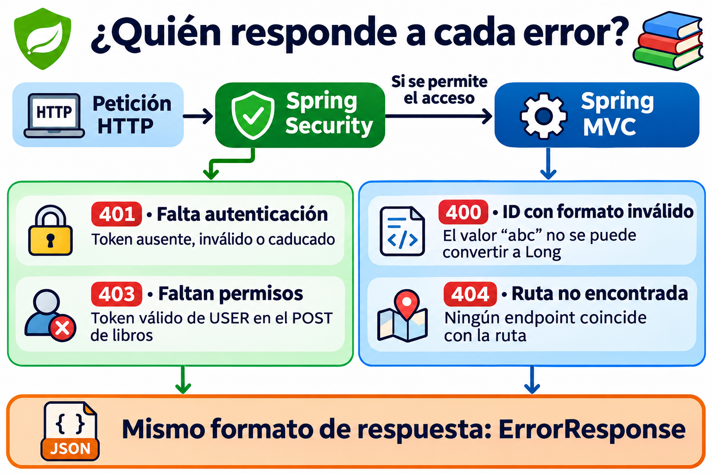
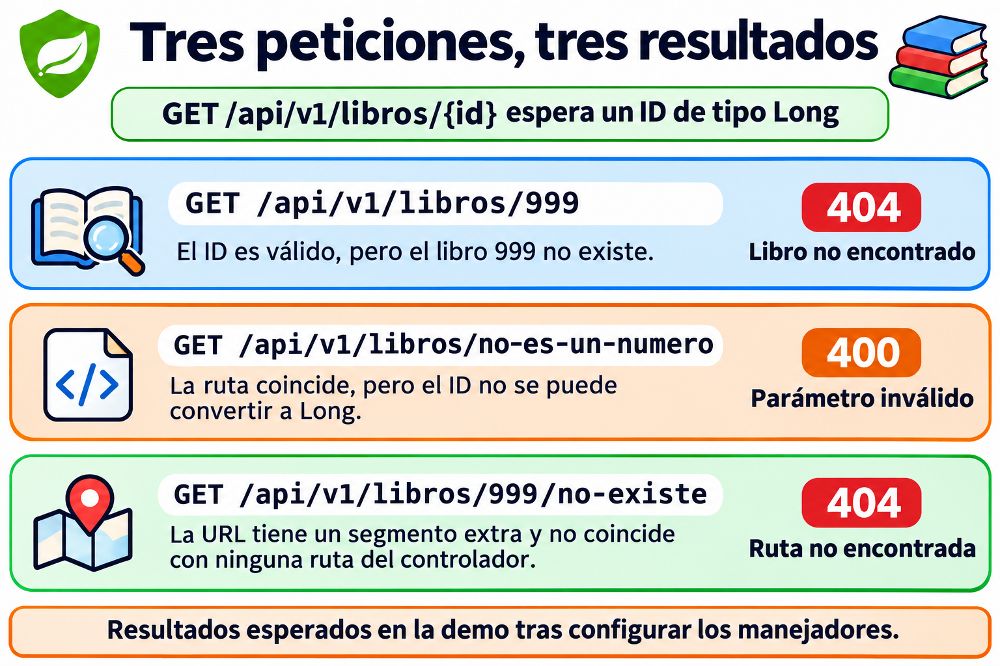

<a id="roles-y-rutas-protegidas"></a>

# 🧩 5. Roles y rutas protegidas

{ type=application/pdf style="width:100%;min-height:80vh" }

!!! info "Descarga de diapositivas"
    [Descarga las diapositivas](diapositivas/roles-y-rutas-protegidas.pptx){target="_blank" rel="noopener"}

En la sesión de JWT probaste a crear un libro con el token de una cuenta `USER`. La API devolvió `403` porque identificó al usuario, pero crear libros exige `ADMIN`. En esta sesión vas a extender esa decisión al resto de rutas de Librería y a reconocer en qué punto se produce cada error para devolverlo con el formato `ErrorResponse`.

## 🗺️ La política de autorización, leída como tabla

El bloque `authorizeHttpRequests` de `SecurityConfig` recoge las reglas de acceso. En Librería, el catálogo es público y el equipo que lo gestiona tiene el rol `ADMIN`. La tabla permite revisar cada permiso antes de escribir el código.

| Ruta o patrón | Método | Acceso |
|---|---|---|
| `/api/v1/auth/register`, `/api/v1/auth/login` | `POST` | Público |
| `/api/v1/auth/me` | `GET` | Cualquier usuario autenticado |
| `/api/v1/libros`, `/api/v1/libros/**`, `/api/v1/editoriales`, `/api/v1/editoriales/**` | `GET` | Público |
| `/api/v1/libros`, `/api/v1/editoriales` | `POST` | `ADMIN` |
| `/api/v1/libros/*`, `/api/v1/editoriales/*` | `PUT`, `DELETE` | `ADMIN` |
| `/documentacion`, `/swagger-ui.html`, `/swagger-ui/**`, `/v3/api-docs/**` | Cualquiera | Público |
| Cualquier petición que no coincida con las reglas anteriores | Cualquiera | Denegado |



*Figura 1. Evaluación de las reglas de acceso según el método HTTP y la ruta. Elaboración propia.*

Sobre la configuración JWT de la sesión anterior, sustituye el bloque `authorizeHttpRequests`. Importa `jakarta.servlet.DispatcherType` para permitir el despacho interno de errores.

```java
.authorizeHttpRequests(auth -> auth
        .dispatcherTypeMatchers(DispatcherType.ERROR).permitAll()
        .requestMatchers(HttpMethod.POST, "/api/v1/auth/register", "/api/v1/auth/login").permitAll()
        .requestMatchers(HttpMethod.GET, "/api/v1/auth/me").authenticated()
        .requestMatchers(HttpMethod.GET, "/api/v1/libros", "/api/v1/libros/**").permitAll()
        .requestMatchers(HttpMethod.GET, "/api/v1/editoriales", "/api/v1/editoriales/**").permitAll()
        .requestMatchers(HttpMethod.POST, "/api/v1/libros", "/api/v1/editoriales").hasRole("ADMIN")
        .requestMatchers(HttpMethod.PUT, "/api/v1/libros/*", "/api/v1/editoriales/*").hasRole("ADMIN")
        .requestMatchers(HttpMethod.DELETE, "/api/v1/libros/*", "/api/v1/editoriales/*").hasRole("ADMIN")
        .requestMatchers("/documentacion", "/swagger-ui.html", "/swagger-ui/**", "/v3/api-docs/**").permitAll()
        .anyRequest().denyAll()
)
```

Spring Security también comprueba el acceso cuando el servidor vuelve a tramitar una petición para presentar un error. La primera regla permite ese despacho interno de tipo `ERROR`, que Spring Boot puede dirigir a `/error`. Una petición HTTP directa a `/error` sigue sujeta a las reglas de rutas. Consulta la [documentación de autorización de Spring Security](https://docs.spring.io/spring-security/reference/servlet/authorization/authorize-http-requests.html).

!!! warning "Revisa las rutas al activar `denyAll()`"
    `/api/v1/auth/me` necesita la regla `authenticated()` que antes aportaba la regla final. Si añades `POST /api/v1/libros/5/aplicar-descuento`, recuerda que la regla del `POST` a `/api/v1/libros` cubre únicamente la ruta de colección.

!!! info "El permiso depende de la operación y del recurso"
    En Librería, borrar un libro es tarea de `ADMIN`. En una red social, un `USER` podría borrar su propia publicación si el servicio comprueba además que es su autor. Al diseñar la política, piensa quién puede realizar la operación y sobre qué recurso.

## 🚦 Dónde se produce cada error

Cuando una solicitud falla, averigua hasta dónde ha llegado. Un rechazo en los filtros de Spring Security ocurre antes de que Spring MVC pueda seleccionar un controlador. Dentro de MVC, la petición también puede fallar al resolver la ruta, al convertir un parámetro o al ejecutar la búsqueda del libro.



*Figura 2. Origen de los errores HTTP en Spring Security y Spring MVC en la API de Librería. Elaboración propia.*

!!! note "La regla `denyAll()` puede acabar en `401` o en `403`"
    En esta configuración, si una petición anónima llega a `denyAll()`, Spring Security activa el `AuthenticationEntryPoint` y devuelve `401`. Si llega con una autenticación válida, activa el `AccessDeniedHandler` y devuelve `403`. En ambos casos el acceso queda denegado.

## 🔎 Resolver los errores de rutas e identificadores en Spring MVC

Prueba las tres peticiones de la figura con **No Auth** en Postman o sin cabecera `Authorization`. Las admite la regla pública de `GET /api/v1/libros/**`. Usa un ID que no exista en tus datos para la primera petición. En la demo, la búsqueda de ese libro ya produce `404` mediante la `ResponseStatusException` que maneja `GlobalExceptionHandler`.



*Figura 3. Respuestas de la API de Librería ante un libro inexistente, un ID inválido y una ruta inexistente. Elaboración propia.*

Si en las otras dos peticiones aparece `500`, comprueba si las está capturando el `@ExceptionHandler(Exception.class)` del primer apartado. Añade los siguientes métodos al mismo `GlobalExceptionHandler`. Para cada una de estas excepciones, Spring MVC selecciona el método específico del mismo `@RestControllerAdvice`.

### 1. ID con formato inválido

La ruta con `no-es-un-numero` encaja en `/api/v1/libros/{id}`. MVC intenta convertir ese segmento a `Long` antes de ejecutar el método del controlador y lanza `MethodArgumentTypeMismatchException` si la conversión falla. Usa `getName()` y `getValue()` para identificar el parámetro y el valor en el mensaje.

```java
@ExceptionHandler(MethodArgumentTypeMismatchException.class)
public ResponseEntity<ErrorResponse> handleMethodArgumentTypeMismatchException(
        MethodArgumentTypeMismatchException ex, HttpServletRequest request) {

    ErrorResponse response = new ErrorResponse(
            LocalDateTime.now().toString(), HttpStatus.BAD_REQUEST.value(),
            "Parámetro inválido",
            "El valor '%s' no es válido para el parámetro '%s'".formatted(ex.getValue(), ex.getName()),
            request.getRequestURI()
    );
    return ResponseEntity.status(HttpStatus.BAD_REQUEST).body(response);
}
```

### 2. Ruta sin controlador

En la demo, `/api/v1/libros/999/no-existe` queda fuera de los patrones del controlador y llega al manejador de recursos estáticos de MVC. Si este no encuentra un recurso, lanza `NoResourceFoundException`. Devuelve `404` con el cuerpo habitual de la API. Consulta la [referencia de `NoResourceFoundException`](https://docs.spring.io/spring-framework/docs/current/javadoc-api/org/springframework/web/servlet/resource/NoResourceFoundException.html).

```java
@ExceptionHandler(NoResourceFoundException.class)
public ResponseEntity<ErrorResponse> handleNoResourceFoundException(
        NoResourceFoundException ex, HttpServletRequest request) {

    ErrorResponse response = new ErrorResponse(
            LocalDateTime.now().toString(), HttpStatus.NOT_FOUND.value(),
            "Recurso no encontrado", "El recurso solicitado no existe",
            request.getRequestURI()
    );
    return ResponseEntity.status(HttpStatus.NOT_FOUND).body(response);
}
```

## 🛡️ Devolver el `403` con `AccessDeniedHandler`

Al intentar crear un libro con el token de `USER`, el rechazo ocurre en Spring Security. Para darle el formato `ErrorResponse`, registra un `AccessDeniedHandler` en la cadena de seguridad. `GlobalExceptionHandler` se encarga de los errores que se resuelven dentro de MVC.

Si ya tienes `ErrorResponseAccessDeniedHandler` de la demo, reutilízalo. Esta es la implementación de referencia.

```java
@Component
@RequiredArgsConstructor
public class ErrorResponseAccessDeniedHandler implements AccessDeniedHandler {

    private final JsonMapper jsonMapper;

    @Override
    public void handle(HttpServletRequest request, HttpServletResponse response,
                       AccessDeniedException accessDeniedException) throws IOException {

        ErrorResponse error = new ErrorResponse(
                LocalDateTime.now().toString(), HttpStatus.FORBIDDEN.value(),
                "No autorizado", "No tienes permisos suficientes para acceder a este recurso",
                request.getRequestURI()
        );

        response.setStatus(HttpStatus.FORBIDDEN.value());
        response.setContentType(MediaType.APPLICATION_JSON_VALUE);
        response.setCharacterEncoding("UTF-8");
        response.getWriter().write(jsonMapper.writeValueAsString(error));
    }
}
```

Añade `ErrorResponseAccessDeniedHandler accessDeniedHandler` a los parámetros del bean `securityFilterChain` y regístralo en `.exceptionHandling(...)`. `bearerEntryPoint` es el punto de entrada de la sesión de JWT. Conserva también su registro en `oauth2ResourceServer(...)` para los errores de validación del token.

```java
.exceptionHandling(exceptions -> exceptions
        .authenticationEntryPoint(bearerEntryPoint)
        .accessDeniedHandler(accessDeniedHandler)
)
```

Comprueba el mismo `POST /api/v1/libros` con un cuerpo válido. Sin token debe devolver `401`. Con un JWT válido de `USER` debe devolver `403`. En ambos, revisa el estado HTTP, el campo `status` del JSON y el `path` de la petición original. Con un JWT de `ADMIN`, la petición pasa la autorización y MVC puede tramitar el alta.

## 📝 Documentar la política de acceso

Una tabla con **método, ruta y permiso** permite comprobar los cambios de seguridad sin leer toda la configuración Java. Al añadir un endpoint, actualiza su regla y su fila en `docs/seguridad.md`. En la [actividad 2.5](actividad_2_5.md) aplicarás este criterio a las rutas de tu propio proyecto.
