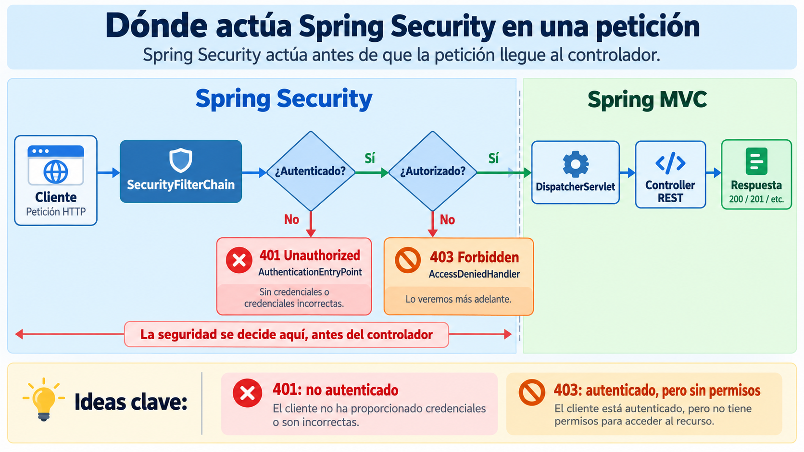
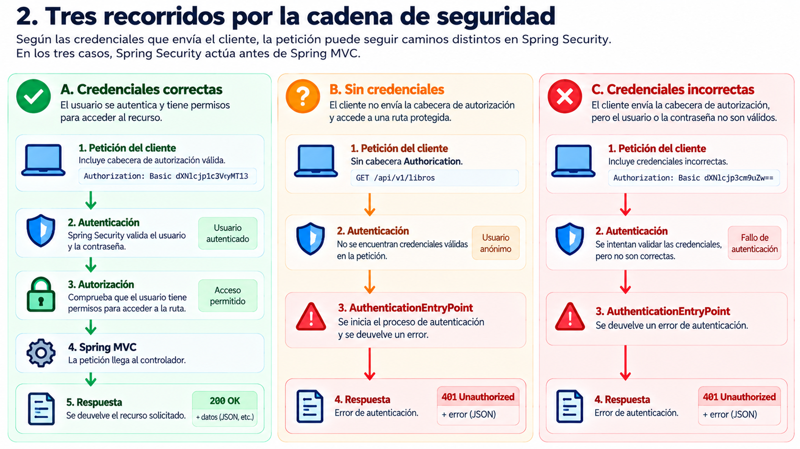
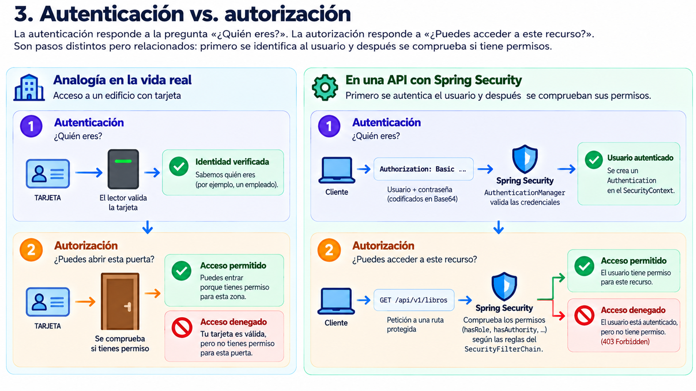
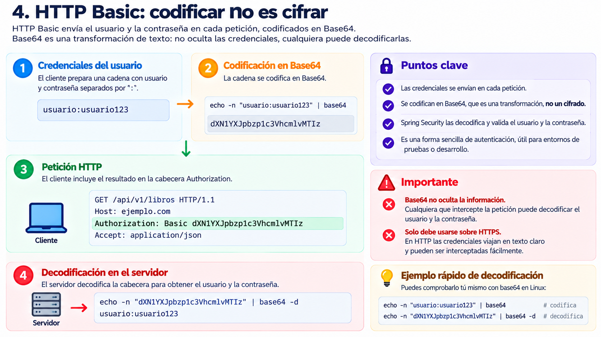
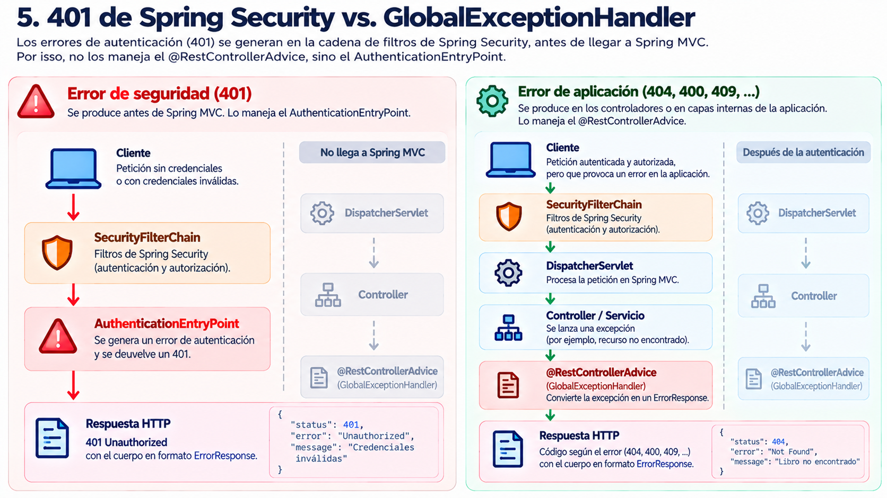

<a id="seguridad-basica-http-basic"></a>

# 🧩 2. Seguridad básica: usuarios en memoria y HTTP Basic

{ type=application/pdf style="width:100%;min-height:80vh" }

!!!info "Descarga de diapositivas"
    [Descarga las diapositivas](diapositivas/seguridad-basica-http-basic.pptx){target="_blank" rel="noopener"}

---

!!! tip "¿Por qué empezar por algo que vas a sustituir?"
    Lo que ves en este apartado —usuarios en memoria y HTTP Basic— no es la versión final. Es un estado **intermedio deliberado**: sus limitaciones explican por qué después necesitaremos usuarios persistidos, contraseñas protegidas con BCrypt y autenticación mediante JWT.

    El recorrido será: **usuarios en memoria + HTTP Basic → PostgreSQL + BCrypt → JWT**. Cada paso resuelve un problema concreto del anterior.

---

## 🔒 Lo primero que hace Spring Security: cerrarlo todo

**Spring Security** es el framework de seguridad del ecosistema Spring. Se encarga de comprobar quién realiza cada petición y qué tiene permiso para hacer, en lugar de obligarte a repetir esa lógica en cada controller.

Si añades `spring-boot-starter-security` al `pom.xml` de una API que hasta ese momento era pública y reinicias sin escribir ninguna configuración propia, el comportamiento cambia inmediatamente. Por ejemplo:

```bash
curl -i http://localhost:8080/api/v1/libros
```

Antes podía devolver un `200 OK`. Con Spring Security presente, pasa a responder `401 Unauthorized` y añade una cabecera como:

```text
WWW-Authenticate: Basic realm="Realm"
```

Spring Security aplica por defecto una política muy restrictiva: **si no se indica expresamente qué puede quedar abierto, exige autenticación**. Es la mínima exposición llevada a la práctica.

Esto ocurre porque Spring Security inserta una **cadena de filtros** delante de Spring MVC. Esos filtros inspeccionan cada petición antes de que alcance el `DispatcherServlet` y deciden si puede continuar.



*Figura 1. Spring Security intercepta la petición antes de que llegue al `DispatcherServlet` y al controller. Elaboración propia.*

La consecuencia principal es sencilla: **una petición puede ser rechazada por seguridad sin que ningún controller llegue a ejecutarse**.

---

## 🚦 Tres recorridos por la cadena de seguridad

El resultado visible puede ser parecido —por ejemplo, dos peticiones distintas pueden acabar en `401`—, pero el camino interno no siempre es el mismo.



*Figura 2. Una petición puede continuar hasta Spring MVC o terminar en `401` por recorridos distintos según las credenciales enviadas. Elaboración propia.*

### 1. Credenciales correctas

Con una cabecera `Authorization` válida, `BasicAuthenticationFilter` extrae las credenciales y el `AuthenticationManager` coordina su comprobación. Para localizar al usuario utiliza un `UserDetailsService`.

Si la autenticación es correcta y la ruta permite el acceso, la petición llega al `DispatcherServlet`, que resuelve el método del controller correspondiente.

```text
Cliente
→ SecurityFilterChain
→ AuthenticationManager
→ UserDetailsService
→ autorización
→ DispatcherServlet
→ Controller
→ 200 OK
```

### 2. Sin cabecera `Authorization`

Si la petición no trae credenciales, no existe nada que validar. La petición continúa como usuario anónimo hasta que la autorización detecta que está intentando acceder a una ruta protegida.

Spring Security activa entonces el `AuthenticationEntryPoint` y devuelve un `401 Unauthorized`. Ni el controller ni el `GlobalExceptionHandler` llegan a intervenir.

### 3. Credenciales incorrectas

Aquí sí existen credenciales y se intenta autenticarlas. El `AuthenticationManager` consulta al `UserDetailsService`, pero el usuario no existe o la contraseña no coincide.

El resultado vuelve a ser un `401 Unauthorized`, aunque el recorrido interno ha sido distinto al caso anterior.

!!! note "El `403` pertenece a otro problema"
    Un `401` significa que la petición **no está autenticada correctamente**. Un `403 Forbidden` aparece cuando Spring Security sí sabe quién eres, pero esa identidad **no tiene permiso** para realizar la operación solicitada. La gestión completa del `403` se trabajará más adelante en el tema.

---

## 🎭 Autenticación vs. autorización

Son dos preguntas distintas y conviene separarlas desde el principio.



*Figura 3. La autenticación comprueba la identidad; la autorización decide qué puede hacer esa identidad. Elaboración propia.*

| | Pregunta | Ejemplo |
|---|---|---|
| **Autenticación** | ¿Quién eres? | Comprobar que usuario y contraseña son válidos. |
| **Autorización** | ¿Puedes hacer esto? | Comprobar si el usuario puede borrar un libro. |

La analogía de una tarjeta de acceso ayuda a distinguirlas: primero el lector verifica que la tarjeta identifica a una persona válida; después, cada puerta comprueba si esa persona tiene permiso para abrirla.

En Spring Security también son responsabilidades separadas. El mecanismo de autenticación puede ser HTTP Basic, JWT u otro distinto, mientras que `authorizeHttpRequests(...)` define las reglas que determinan qué puede hacer el usuario ya identificado.

---

## 📦 HTTP Basic: codificar no es cifrar

**HTTP Basic** es uno de los mecanismos de autenticación más sencillos de HTTP. El cliente construye una cadena con usuario y contraseña separados por `:` y la codifica en Base64.



*Figura 4. HTTP Basic codifica `usuario:contraseña` en Base64 y lo envía en cada petición; Base64 no cifra las credenciales. Elaboración propia.*

Por ejemplo:

```text
user:user123
    ↓ Base64
dXNlcjp1c2VyMTIz
```

La cabecera enviada es:

```text
Authorization: Basic dXNlcjp1c2VyMTIz
```

Puedes comprobar que la transformación es reversible sin ninguna clave:

```bash
echo "dXNlcjp1c2VyMTIz" | base64 -d
```

Resultado:

```text
user:user123
```

!!! danger "Base64 NO es cifrado"
    Base64 solo representa bytes como texto. Cualquiera que intercepte la cabecera puede recuperar el usuario y la contraseña.

    Por eso HTTP Basic solo debe utilizarse sobre **HTTPS**. Sin cifrado en el transporte, las credenciales viajan prácticamente en claro y, además, se repiten en cada petición.

---

## 🧑‍🤝‍🧑 Usuarios en memoria y una primera política de rutas

Para comprender el mecanismo sin introducir todavía persistencia, Spring Security permite declarar usuarios directamente en memoria mediante `InMemoryUserDetailsManager`.

```java
@Bean
public UserDetailsService userDetailsService() {
    UserDetails user = User.withUsername("user")
            .password("{noop}user123")
            .roles("USER")
            .build();

    UserDetails admin = User.withUsername("admin")
            .password("{noop}admin123")
            .roles("ADMIN")
            .build();

    return new InMemoryUserDetailsManager(user, admin);
}
```

`InMemoryUserDetailsManager` implementa `UserDetailsService`: cuando Spring Security necesita localizar un usuario, consulta este almacén en memoria.

El prefijo `{noop}` indica que la contraseña está almacenada en texto claro y debe compararse sin aplicar ningún `PasswordEncoder`. Es válido como demostración, pero precisamente constituye una de las limitaciones que resolveremos en la siguiente sesión.

!!! tip "`.roles("USER")` termina siendo `ROLE_USER`"
    Spring Security añade automáticamente el prefijo `ROLE_`. Por eso `.roles("USER")` registra internamente `ROLE_USER`, y `.roles("ADMIN")` registra `ROLE_ADMIN`.

Con los usuarios definidos, podemos establecer una primera política de acceso:

```java
@Bean
public SecurityFilterChain securityFilterChain(HttpSecurity http) throws Exception {
    return http
            .authorizeHttpRequests(auth -> auth
                    .requestMatchers(HttpMethod.GET, "/api/v1/libros/**").permitAll()
                    .anyRequest().authenticated()
            )
            .csrf(AbstractHttpConfigurer::disable)
            .httpBasic(Customizer.withDefaults())
            .build();
}
```

Léela de arriba abajo:

| Pieza | Qué significa |
|---|---|
| `.requestMatchers(HttpMethod.GET, "/api/v1/libros/**")` | Selecciona los `GET` del catálogo de libros y sus subrutas. |
| `.permitAll()` | Permite esas peticiones incluso sin autenticación. |
| `.anyRequest()` | Representa cualquier petición que no haya coincidido antes. |
| `.authenticated()` | Exige un usuario válido, sin comprobar todavía un rol concreto. |
| `.csrf(AbstractHttpConfigurer::disable)` | Desactiva CSRF para esta API y este mecanismo de credenciales. |
| `.httpBasic(Customizer.withDefaults())` | Activa HTTP Basic como mecanismo de autenticación. |

!!! warning "El orden de las reglas importa"
    Spring Security evalúa las reglas de `authorizeHttpRequests` de arriba abajo y aplica la **primera que encaja**. Si `.anyRequest().authenticated()` apareciera antes de la regla pública de `/api/v1/libros/**`, esa regla posterior no llegaría a utilizarse.

    Por tanto, las reglas concretas deben aparecer antes que las generales.

!!! warning "Por qué desactivamos CSRF aquí"
    Sin `.csrf(AbstractHttpConfigurer::disable)`, una petición `POST`, `PUT` o `DELETE` puede ser rechazada con `403 Forbidden` por el `CsrfFilter`, incluso aunque las credenciales HTTP Basic sean válidas.

    CSRF resulta especialmente importante cuando el navegador adjunta automáticamente las credenciales, como ocurre con cookies de sesión. En esta API el cliente envía explícitamente la cabecera `Authorization` y no estamos utilizando autenticación basada en cookies, por lo que lo desactivamos para simplificar este escenario.

    Esto **no significa que CSRF deba desactivarse en cualquier API REST**: la decisión depende de cómo se transporten las credenciales.

Esta política sigue siendo provisional: los `GET` del catálogo son públicos y el resto exige simplemente estar autenticado. Más adelante construiremos una matriz de rutas completa con permisos por rol.

---

## 🩹 Cerrando la grieta: `AuthenticationEntryPoint`

En la sesión anterior construiste un `GlobalExceptionHandler` para que los errores de la aplicación utilizaran siempre el mismo `ErrorResponse`. Sin embargo, un `401` producido por Spring Security no pasa por ese handler.



*Figura 5. Los errores de autenticación se producen antes de Spring MVC y necesitan un `AuthenticationEntryPoint`; las excepciones de la aplicación sí pueden pasar por `@RestControllerAdvice`. Elaboración propia.*

La razón es arquitectónica: el fallo de autenticación ocurre dentro de la cadena de filtros, **antes** de que la petición llegue al `DispatcherServlet`. Por tanto, añadir otro `@ExceptionHandler` no resolvería el problema: Spring MVC nunca llega a recibir esa petición.

Spring Security dispone de una pieza específica: **`AuthenticationEntryPoint`**. Su método `commence(...)` se ejecuta cuando una petición no autenticada intenta acceder a un recurso protegido.

```java
@Component
@RequiredArgsConstructor
public class ErrorResponseAuthenticationEntryPoint implements AuthenticationEntryPoint {

    private final JsonMapper jsonMapper;

    @Override
    public void commence(HttpServletRequest request, HttpServletResponse response,
                         AuthenticationException authException) throws IOException {

        ErrorResponse error = new ErrorResponse(
                LocalDateTime.now().toString(),
                HttpStatus.UNAUTHORIZED.value(),
                "No autenticado",
                "Se requieren credenciales válidas para acceder a este recurso",
                request.getRequestURI()
        );

        response.setStatus(HttpStatus.UNAUTHORIZED.value());
        response.setContentType(MediaType.APPLICATION_JSON_VALUE);
        response.setCharacterEncoding("UTF-8");
        response.getWriter().write(jsonMapper.writeValueAsString(error));
    }
}
```

Aquí no devolvemos un `ResponseEntity<ErrorResponse>` porque no estamos dentro del circuito normal de Spring MVC. Trabajamos directamente con `HttpServletResponse` y utilizamos `JsonMapper` para convertir manualmente `ErrorResponse` a JSON.

!!! tip "No necesitas memorizar esta clase"
    Lo importante es entender **por qué existe**. Los detalles de `commence(...)`, `HttpServletResponse` y `JsonMapper` son mecánicos y se adaptan de forma muy parecida entre proyectos.

Falta registrar esta pieza en la configuración:

```java
@Bean
public SecurityFilterChain securityFilterChain(
        HttpSecurity http,
        AuthenticationEntryPoint customAuthenticationEntryPoint) throws Exception {

    return http
            .authorizeHttpRequests(auth -> auth
                    .requestMatchers(HttpMethod.GET, "/api/v1/libros/**").permitAll()
                    .anyRequest().authenticated()
            )
            .exceptionHandling(exceptions -> exceptions
                    .authenticationEntryPoint(customAuthenticationEntryPoint)
            )
            .csrf(AbstractHttpConfigurer::disable)
            .httpBasic(Customizer.withDefaults())
            .build();
}
```

`exceptionHandling(...)` está separado de `httpBasic(...)`. Esa decisión es útil porque el formato del `401` no depende necesariamente del mecanismo concreto de autenticación. Cuando HTTP Basic sea sustituido por JWT, el `AuthenticationEntryPoint` podrá seguir registrado en el mismo lugar.

!!! note "El `403` tiene la misma grieta"
    Un usuario correctamente autenticado pero sin permisos recibe un `403 Forbidden`. Ese error también se genera en Spring Security, fuera de `GlobalExceptionHandler`.

    La pieza equivalente es `AccessDeniedHandler`. La construiremos más adelante, cuando completemos la política de autorización.

---

## ⚠️ Las limitaciones de esta versión — a propósito

La solución actual funciona, pero tiene dos problemas importantes que hemos introducido deliberadamente:

1. **Usuarios definidos en código y sin persistencia.** `user` y `admin` se reconstruyen cada vez que arranca la aplicación, sus contraseñas aparecen en el código y cualquier cambio se pierde al reiniciar.
2. **Las credenciales completas viajan en cada petición.** HTTP Basic vuelve a enviar usuario y contraseña continuamente, simplemente codificados en Base64.

Cada problema conduce al siguiente paso del tema:

```text
Usuarios en memoria
      ↓
PostgreSQL + BCrypt

HTTP Basic
      ↓
JWT
```

En el próximo apartado resolveremos el primero: los usuarios pasarán a PostgreSQL y las contraseñas dejarán de almacenarse en texto claro.

---

## ✅ Ideas clave

??? tip "Abrir resumen"

    - Spring Security inserta una **cadena de filtros antes de Spring MVC** y, por defecto, protege todas las rutas.
    - **Autenticación** responde a “¿quién eres?”; **autorización** responde a “¿puedes hacer esto?”.
    - Dos peticiones pueden acabar en `401` por caminos distintos: no enviar credenciales y enviar credenciales incorrectas no son el mismo caso interno.
    - HTTP Basic envía `usuario:contraseña` en Base64 en cada petición. **Base64 codifica, no cifra**, por lo que Basic solo debe utilizarse sobre HTTPS.
    - `InMemoryUserDetailsManager` permite declarar usuarios de forma sencilla, pero es un almacén provisional y las contraseñas con `{noop}` permanecen en texto claro.
    - Las reglas de `authorizeHttpRequests` se evalúan de arriba abajo: las más concretas deben ir antes que `anyRequest()`.
    - En esta API desactivamos CSRF porque las credenciales se envían explícitamente en `Authorization` y no usamos autenticación basada en cookies.
    - Los errores `401` de Spring Security se producen antes del `DispatcherServlet`, por lo que no los captura `GlobalExceptionHandler`.
    - `AuthenticationEntryPoint` permite dar a esos `401` el mismo formato `ErrorResponse` que al resto de la API.
    - Este estado es deliberadamente provisional: la siguiente sesión sustituirá los usuarios en memoria por PostgreSQL + BCrypt y, después, JWT sustituirá a HTTP Basic.
