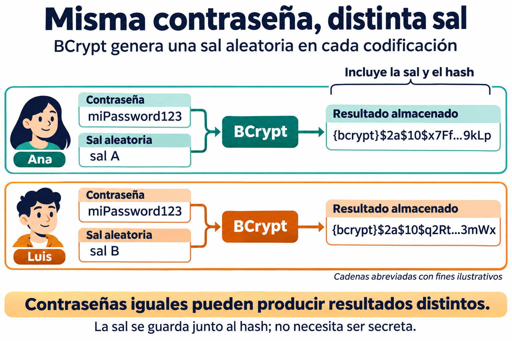
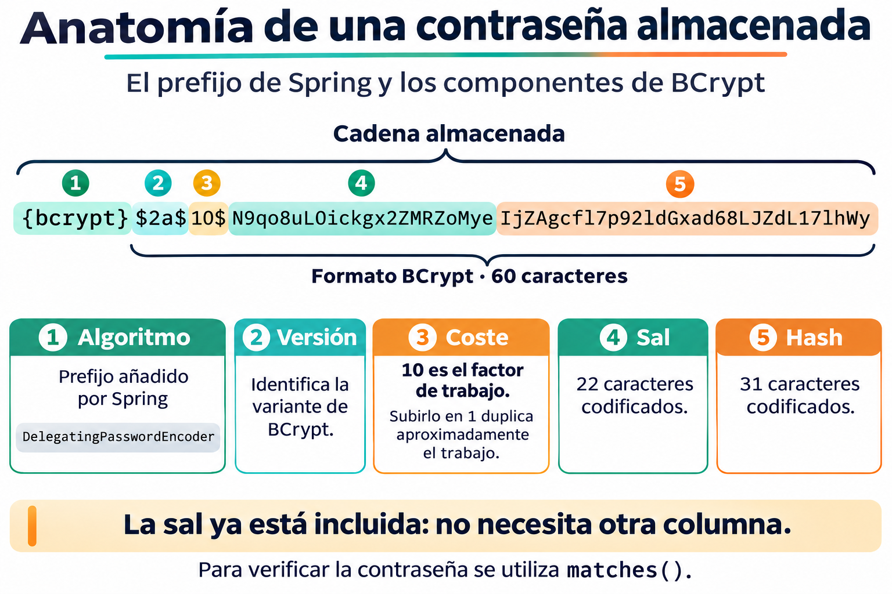
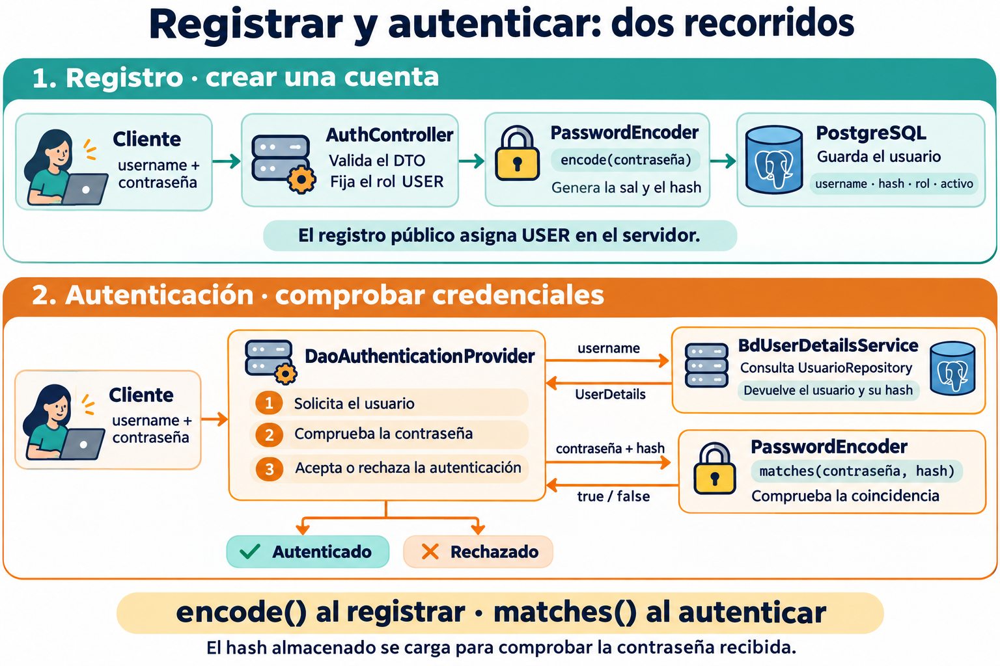
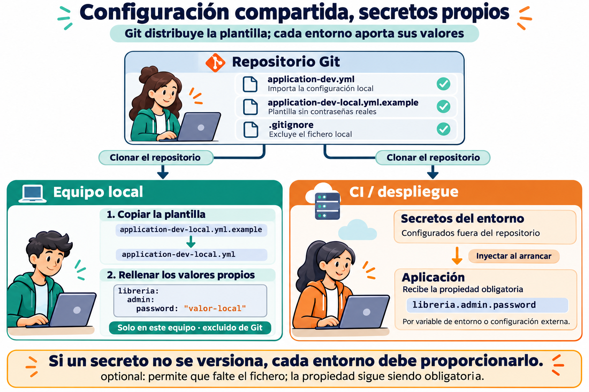

<a id="usuarios-persistidos-bcrypt"></a>

# 3. Usuarios persistidos y BCrypt

{ type=application/pdf style="width:100%;min-height:80vh" }

!!! info "Descarga de diapositivas"
    [Descarga las diapositivas](diapositivas/usuarios-persistidos-bcrypt.pptx){target="_blank" rel="noopener"}

## 📍 De dónde partimos

En el apartado anterior, la API ya distinguía **autenticación** de **autorización**, pero los usuarios `user` y `admin` estaban definidos en un `InMemoryUserDetailsManager`, con contraseñas en texto claro mediante `{noop}`. Además, HTTP Basic enviaba las credenciales en cada petición, codificadas en Base64.

Ahora sustituirás ese almacén provisional por usuarios persistidos en **PostgreSQL**, cuyas contraseñas se protegerán mediante **BCrypt**. Los ejemplos utilizan la aplicación Librería.

!!! tip "Una pieza que se mantiene"
    La persistencia de usuarios y la protección de contraseñas seguirán siendo necesarias cuando incorpores JWT. En este apartado mantienes HTTP Basic; más adelante cambiará la forma de presentar las credenciales.

## 🔐 Proteger las contraseñas

Para autenticar a una persona necesitas comprobar su contraseña sin guardar una copia legible. Antes de implementar las clases, conviene entender qué se almacena y por qué.

### 1. Cifrar y hashear

| Operación | ¿Permite recuperar el original? | Uso habitual |
|---|---|---|
| **Cifrar** | Sí, utilizando la clave correspondiente. | Proteger información que después necesitas recuperar. |
| **Hashear** | No incorpora una operación de descifrado. | Obtener un resultado con el que comprobar una entrada. |

Al almacenar contraseñas, la aplicación guarda un **hash**. Cuando recibe una contraseña para autenticar al usuario, comprueba si corresponde al resultado almacenado.

!!! warning "Un hash no impide probar candidatos"
    Un atacante que robe los hashes puede probar contraseñas hasta encontrar una que coincida. Por eso importan tanto la calidad de la contraseña como el algoritmo utilizado para protegerla.

### 2. La sal: contraseñas iguales, resultados distintos

Sin sal, una misma contraseña produciría siempre el mismo resultado. Eso permitiría reconocer coincidencias entre usuarios y reutilizar cálculos preparados de antemano.

La **sal** (*salt*) es un valor aleatorio que interviene en el cálculo. Al generar una nueva sal en cada codificación, la misma contraseña puede producir resultados distintos, incluso si vuelves a codificarla para el mismo usuario.



*Figura 1. Una misma contraseña produce resultados distintos al utilizar sales diferentes. Elaboración propia.*

La sal se almacena junto al hash y no necesita ser secreta. Su función es impedir la comparación directa de resultados y la reutilización de un único cálculo para todos los usuarios.

??? info "Tablas arcoíris"
    Son estructuras precalculadas que permiten buscar contraseñas a partir de sus hashes. Una sal aleatoria dificulta su reutilización: los cálculos tendrían que considerar también la sal concreta de cada resultado almacenado.

### 3. BCrypt: aumentar el coste de cada intento

SHA-256 es una función hash rápida y útil en otros contextos, pero utilizarla directamente para almacenar contraseñas permite probar candidatos con demasiada rapidez.

**BCrypt** incorpora sal y un **factor de coste** que regula el trabajo necesario para calcular o comprobar una contraseña. Subir el coste en una unidad duplica aproximadamente ese trabajo.

| Factor de coste | Trabajo aproximado respecto al coste 10 |
|---|---|
| 10 | Referencia: ×1 |
| 11 | ×2 |
| 12 | ×4 |

El objetivo es encarecer los intentos masivos manteniendo un tiempo de autenticación asumible. El tiempo concreto depende del equipo y de la carga; esta tabla compara trabajo relativo, no garantiza milisegundos.

## 🗄️ Persistir y cargar usuarios

La implementación combina una entidad JPA, un codificador de contraseñas y un servicio que permite a Spring Security consultar los usuarios. Primero verás cada pieza; después, cómo colaboran al registrar y autenticar.

### 1. La entidad `Usuario`

```java
@Entity
@Table(name = "usuarios")
public class Usuario {

    @Id
    @GeneratedValue(strategy = GenerationType.IDENTITY)
    private Long id;

    @Column(nullable = false, unique = true)
    private String username;

    @Column(nullable = false)
    private String password;

    @Enumerated(EnumType.STRING)
    private RolUsuario rol;

    private boolean activo = true;
}
```

Es una entidad JPA como las que ya utilizas en Acceso a Datos. El campo `password` almacenará la cadena codificada completa, incluido el prefijo de Spring, en lugar de la contraseña recibida.

El rol se representa con el enum presentado en el apartado anterior:

```java
public enum RolUsuario {
    ADMIN,
    USER
}
```

El campo `activo` permite deshabilitar una cuenta sin borrar su fila. Así puedes conservar sus relaciones con otros datos; el histórico de cambios dependerá de cómo lo haya modelado la aplicación.

El repositorio añade una búsqueda por nombre de usuario:

```java
public interface UsuarioRepository extends JpaRepository<Usuario, Long> {
    Optional<Usuario> findByUsername(String username);
}
```

Los fragmentos omiten imports y métodos de acceso para centrarse en la configuración de seguridad. La entidad debe disponer de los getters y setters utilizados en los ejemplos.

### 2. El bean `PasswordEncoder`

```java
@Bean
public PasswordEncoder passwordEncoder() {
    return PasswordEncoderFactories.createDelegatingPasswordEncoder();
}
```

`createDelegatingPasswordEncoder()` crea un `DelegatingPasswordEncoder` que utiliza BCrypt para las nuevas contraseñas en esta configuración. El prefijo `{bcrypt}` identifica el algoritmo y permite seleccionar el verificador correspondiente al leer la cadena almacenada.



*Figura 2. Prefijo de Spring y componentes de una cadena BCrypt: versión, coste, sal y hash. Elaboración propia.*

El bean ofrece dos operaciones que utilizarás en momentos diferentes:

| Operación | Momento | Resultado |
|---|---|---|
| `encode(contraseña)` | Al crear o cambiar la contraseña. | Una nueva cadena codificada para guardar. |
| `matches(contraseña, hashAlmacenado)` | Al comprobar las credenciales. | `true` o `false`. |

!!! warning "Verificar con `matches()`"
    No compares `encode(contraseña)` con el valor guardado: una nueva codificación genera otra sal. `matches()` utiliza la información incluida en la cadena almacenada para realizar la comprobación.

El prefijo también facilita mantener contraseñas antiguas si se cambia de algoritmo, siempre que el encoder conserve soporte para sus identificadores.

### 3. Un `UserDetailsService` que consulta PostgreSQL

```java
@Service
@RequiredArgsConstructor
public class BdUserDetailsService implements UserDetailsService {

    private final UsuarioRepository usuarioRepository;

    @Override
    public UserDetails loadUserByUsername(String username) throws UsernameNotFoundException {
        Usuario usuario = usuarioRepository.findByUsername(username)
                .orElseThrow(() -> new UsernameNotFoundException("Usuario no encontrado: " + username));

        return User.withUsername(usuario.getUsername())
                .password(usuario.getPassword())
                .roles(usuario.getRol().name())
                .disabled(!usuario.isActivo())
                .build();
    }
}
```

`BdUserDetailsService` sustituye al `InMemoryUserDetailsManager`: busca al usuario en el repositorio y adapta sus datos al objeto `UserDetails` que entiende Spring Security.

La llamada `.password(usuario.getPassword())` entrega el hash almacenado. Este servicio **carga los datos**, mientras que la comprobación de la contraseña se realiza mediante el `PasswordEncoder`.

Con `.disabled(!usuario.isActivo())`, una cuenta inactiva sigue existiendo en PostgreSQL, pero Spring Security rechaza su autenticación.

!!! tip "Sustituir el almacén provisional"
    Retira el bean `InMemoryUserDetailsManager` anterior. En la configuración de estos apuntes, Spring Security utiliza el nuevo `UserDetailsService` y el bean `PasswordEncoder` para autenticar por usuario y contraseña.

    Este cambio no exige modificar por sí mismo las reglas de acceso, HTTP Basic ni la gestión de errores de `securityFilterChain`. Más adelante abrirás una ruta nueva porque añadirás el registro público.

## 🔄 Registrar y autenticar

Registrar crea una cuenta; autenticar comprueba las credenciales de una cuenta existente. La figura relaciona las clases anteriores con ambos recorridos.



*Figura 3. Registro y autenticación de usuarios: almacenamiento y comprobación de contraseñas con BCrypt. Elaboración propia.*

!!! info "`DaoAuthenticationProvider` lo proporciona Spring Security"
    No tienes que programar esa clase. Coordina la autenticación utilizando el `UserDetailsService` y el `PasswordEncoder`. Tú implementas `BdUserDetailsService` y declaras el bean del encoder; el proveedor utiliza ambas piezas.

### 1. El registro público: `AuthController`

El registro recibe los datos de la cuenta mediante un DTO. El cliente aporta el nombre y la contraseña; los privilegios los decide el servidor.

```java
public record RegisterRequestDTO(
        @NotBlank(message = "El nombre de usuario no puede estar vacío") String username,
        @NotBlank(message = "La contraseña no puede estar vacía") String password
) {}
```

```java
@RestController
@RequestMapping("/api/v1/auth")
@RequiredArgsConstructor
public class AuthController {

    private final UsuarioRepository usuarioRepository;
    private final PasswordEncoder passwordEncoder;

    @Operation(summary = "Registrar un nuevo usuario")
    @ApiResponses({
            @ApiResponse(responseCode = "201", description = "Usuario creado correctamente"),
            @ApiResponse(responseCode = "400", description = "El cuerpo de la petición no supera las validaciones"),
            @ApiResponse(responseCode = "409", description = "Ya existe un usuario con ese nombre")
    })
    @PostMapping("/register")
    public ResponseEntity<Void> register(@Valid @RequestBody RegisterRequestDTO dto) {
        Usuario usuario = new Usuario();
        usuario.setUsername(dto.username());
        usuario.setPassword(passwordEncoder.encode(dto.password()));
        usuario.setRol(RolUsuario.USER);
        usuarioRepository.save(usuario);
        return ResponseEntity.status(HttpStatus.CREATED).build();
    }
}
```

`encode(...)` produce la cadena que se guarda en `password`. Si el nombre ya existe, la restricción `unique = true` provoca un error de integridad: tu `GlobalExceptionHandler` lo convierte en `409 Conflict`, como en el primer apartado del tema.

!!! warning "El cliente no elige sus privilegios"
    El DTO no incluye el rol. `RolUsuario.USER` se asigna en el servidor para impedir que alguien se registre como `ADMIN` enviando ese valor en el JSON.

Para permitir el registro sin autenticación, añade esta regla **antes de `anyRequest().authenticated()`** en la política de acceso:

```java
.requestMatchers(HttpMethod.POST, "/api/v1/auth/register").permitAll()
```

### 2. El primer administrador: `ApplicationRunner`

Como el registro público solo crea cuentas `USER`, el primer administrador se incorpora mediante un proceso de inicialización o *seed*.

`ApplicationRunner` permite ejecutar código en cada arranque, después de crear el contexto y antes de que Spring Boot considere preparada la aplicación. La anotación `@Component` hace que detecte esta implementación:

```java
@Component
@RequiredArgsConstructor
public class UsuariosSeed implements ApplicationRunner {

    private final UsuarioRepository usuarioRepository;
    private final PasswordEncoder passwordEncoder;

    @Value("${libreria.admin.password}")
    private String adminPassword;

    @Override
    public void run(ApplicationArguments args) {
        if (usuarioRepository.findByUsername("admin").isEmpty()) {
            Usuario admin = new Usuario();
            admin.setUsername("admin");
            admin.setPassword(passwordEncoder.encode(adminPassword));
            admin.setRol(RolUsuario.ADMIN);
            usuarioRepository.save(admin);
        }
    }
}
```

El `if (...isEmpty())` evita insertar de nuevo al administrador cuando ya existe. La contraseña procede de la propiedad externa `libreria.admin.password` y se codifica con el mismo encoder que utiliza el registro.

!!! note "Inicializar no significa actualizar"
    Cambiar esa propiedad después de crear `admin` no modifica su contraseña: este código solo actúa cuando la cuenta todavía no existe. Tampoco reactiva ni cambia el rol de una cuenta existente.

## 🔑 Configuración compartida y secretos

Sacar la contraseña del código Java es solo el primer paso. Si la escribes en un fichero versionado, seguirá siendo visible en el repositorio. La configuración compartida debe indicar qué necesita la aplicación; cada entorno debe proporcionar sus valores secretos.



*Figura 4. Distribución de la configuración mediante Git y suministro de secretos en cada entorno. Elaboración propia.*

### 1. Configurar el entorno local

En el perfil de desarrollo, importa un fichero adicional que quedará fuera de Git:

```yaml
# application-dev.yml (versionado)
spring:
  config:
    import: "optional:application-dev-local.yml"
```

Junto a él, guarda una plantilla que permita conocer las propiedades necesarias:

```yaml
# application-dev-local.yml.example (versionado, sin secretos reales)
libreria:
  admin:
    password: "pon-aqui-tu-propia-contraseña"
```

Cada persona copia la plantilla a `application-dev-local.yml` y sustituye el marcador por su contraseña. Ambos ficheros se sitúan junto a `application-dev.yml`; el perfil `dev` debe estar activo para cargar esta configuración.

Incluye el fichero local en `.gitignore`, manteniendo versionada la plantilla:

```gitignore
application-dev-local.yml
```

!!! warning "Ignorar un fichero no lo retira del historial"
    La regla debe aplicarse antes de añadir el fichero a Git. Si ya se ha publicado una contraseña real, añadirla a `.gitignore` no borra los commits anteriores ni sustituye la necesidad de cambiarla.

### 2. Proporcionar valores en otros entornos

`optional:` permite que falte el fichero importado. Sin embargo, `@Value("${libreria.admin.password}")` exige que exista la propiedad: si ninguna fuente la proporciona, la aplicación no completa el arranque.

Esto también se cumple cuando `admin` ya existe: Spring debe resolver el campo anotado con `@Value` al crear `UsuariosSeed`, antes de ejecutar la búsqueda del usuario.

Un servidor o un proceso de CI que arranque la aplicación completa necesitará recibir el valor mediante su configuración externa o su sistema de secretos. El fichero local de tu equipo no llega allí al clonar el repositorio.

??? example "Ejemplo para una futura prueba de integración en GitHub Actions"
    Si un workflow necesita arrancar la aplicación completa, puedes guardar el valor como un secreto del repositorio llamado `LIBRERIA_ADMIN_PASSWORD` y exponerlo como variable de entorno:

    ```yaml
    - name: Ejecutar las pruebas
      env:
        LIBRERIA_ADMIN_PASSWORD: ${{ secrets.LIBRERIA_ADMIN_PASSWORD }}
      run: ./mvnw test
    ```

    Spring Boot permite proporcionar `libreria.admin.password` mediante esa variable. Un test aislado que no cargue `UsuariosSeed` no necesita esta propiedad por ese componente. Esta ampliación no requiere modificar ahora el workflow de la actividad.

El mismo criterio se aplica a otras credenciales, como las de PostgreSQL, y al secreto de JWT que incorporarás después. Los valores de demostración de un entorno local no deben reutilizarse en un despliegue real.

## 🧭 El siguiente paso

Los usuarios ya viven en PostgreSQL y la aplicación puede comprobar sus contraseñas sin guardar el texto original. Sin embargo, con HTTP Basic el cliente sigue enviando las credenciales en cada petición.

JWT permitirá presentar un token en las peticiones posteriores a la autenticación. Tanto las credenciales como los tokens requieren **HTTPS** para proteger su transmisión; Base64 y JWT no sustituyen el cifrado del transporte.

## ✅ Ideas clave

??? tip "Abrir resumen"
    - **BCrypt combina sal y coste** para dificultar la reutilización de cálculos y encarecer cada intento de adivinación.
    - **`encode()` guarda; `matches()` comprueba.** La sal está incluida en la cadena almacenada.
    - **`BdUserDetailsService` carga usuarios.** Spring Security coordina la comprobación mediante `DaoAuthenticationProvider` y `PasswordEncoder`.
    - **El servidor asigna los roles.** El registro público crea cuentas `USER`; el administrador inicial se incorpora mediante un *seed*.
    - **Git comparte la configuración y la plantilla.** Cada entorno proporciona sus secretos; una propiedad obligatoria debe existir aunque la importación del fichero sea opcional.

<!-- Referencia técnica: https://docs.spring.io/spring-security/reference/servlet/authentication/passwords/dao-authentication-provider.html -->
